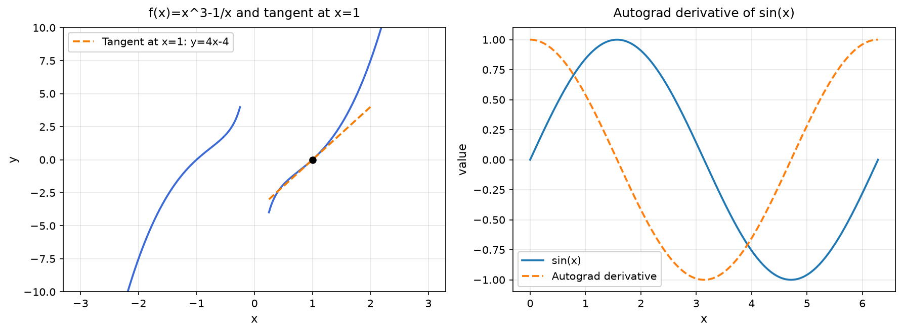

# 2. Preliminaries: Dive into Deep Learning 1.0.3

## 2.4. Calculus: Giải tích vi phân trong Học sâu

Nguồn tham khảo: [2.4.6. Exercises: Dive into Deep Learning 1.0.3](https://d2l.ai/chapter_preliminaries/calculus.html#exercises).

---

### Bài 1: Derivatives from the limit definition

**Đề bài:** Vận dụng định nghĩa đạo hàm bằng giới hạn để chứng minh công thức đạo hàm của hàm hằng, hàm lũy thừa, hàm mũ và hàm logarit tự nhiên.

**Chứng minh:**

Đạo hàm của hàm khả vi $f: \mathbb{R} \to \mathbb{R}$ tại điểm $x$ được định nghĩa:

$$f'(x) = \lim_{h \to 0} \frac{f(x + h) - f(x)}{h}$$

1. **Hàm hằng:** $f(x) = c$.
   $$f'(x) = \lim_{h \to 0} \frac{c - c}{h} = \lim_{h \to 0} 0 = 0$$

2. **Hàm lũy thừa:** $f(x) = x^n$ ($n \in \mathbb{N}^*$). Khai triển nhị thức Newton $(x + h)^n = x^n + n x^{n-1}h + \binom{n}{2}x^{n-2}h^2 + \dots + h^n$:
   $$f'(x) = \lim_{h \to 0} \frac{n x^{n-1}h + \mathcal{O}(h^2)}{h} = \lim_{h \to 0} \left( n x^{n-1} + \mathcal{O}(h) \right) = n x^{n-1}$$

3. **Hàm mũ tự nhiên:** $f(x) = e^x$. Sử dụng giới hạn cơ bản $\lim_{h \to 0} \frac{e^h - 1}{h} = 1$:
   $$f'(x) = \lim_{h \to 0} \frac{e^{x+h} - e^x}{h} = e^x \lim_{h \to 0} \frac{e^h - 1}{h} = e^x \cdot 1 = e^x$$

4. **Hàm logarit tự nhiên:** $f(x) = \ln x$ ($x > 0$). Sử dụng giới hạn cơ bản $\lim_{u \to 0} \frac{\ln(1 + u)}{u} = 1$:
   $$f'(x) = \lim_{h \to 0} \frac{\ln(x + h) - \ln x}{h} = \lim_{h \to 0} \frac{\ln\left(1 + \frac{h}{x}\right)}{h} = \frac{1}{x} \lim_{u \to 0} \frac{\ln(1 + u)}{u} = \frac{1}{x} \quad \left(\text{đặt } u = \frac{h}{x}\right)$$

---

### Bài 2: Product, sum, and quotient rules from first principles

**Đề bài:** Thiết lập các quy tắc tính đạo hàm của tổng, tích và thương của hai hàm khả vi từ định nghĩa giới hạn.

**Chứng minh:**

1. **Quy tắc tổng:**
   $$(f + g)'(x) = \lim_{h \to 0} \frac{[f(x+h) + g(x+h)] - [f(x) + g(x)]}{h} = \lim_{h \to 0} \frac{f(x+h) - f(x)}{h} + \lim_{h \to 0} \frac{g(x+h) - g(x)}{h} = f'(x) + g'(x)$$

2. **Quy tắc tích:** Bổ sung và triệt tiêu số hạng chéo $f(x+h)g(x)$ ở tử số:
   $$\begin{aligned}
   (fg)'(x) &= \lim_{h \to 0} \frac{f(x+h)g(x+h) - f(x)g(x)}{h} \\
   &= \lim_{h \to 0} \left[ f(x+h) \frac{g(x+h) - g(x)}{h} + g(x) \frac{f(x+h) - f(x)}{h} \right] \\
   &= f(x)g'(x) + f'(x)g(x) \quad (\text{do } f \text{ liên tục nên } \lim_{h \to 0} f(x+h) = f(x))
   \end{aligned}$$

3. **Quy tắc thương:** Giả định $g(x) \ne 0$:
   $$\begin{aligned}
   \left(\frac{f}{g}\right)'(x) &= \lim_{h \to 0} \frac{\frac{f(x+h)}{g(x+h)} - \frac{f(x)}{g(x)}}{h} = \lim_{h \to 0} \frac{f(x+h)g(x) - f(x)g(x+h)}{h \cdot g(x+h)g(x)} \\
   &= \lim_{h \to 0} \frac{[f(x+h) - f(x)]g(x) - f(x)[g(x+h) - g(x)]}{h \cdot g(x+h)g(x)} = \frac{f'(x)g(x) - f(x)g'(x)}{g(x)^2}
   \end{aligned}$$

---

### Bài 3: Constant multiple rule

**Đề bài:** Suy biến quy tắc nhân hàm với một hằng số thực $c \in \mathbb{R}$ từ quy tắc tích.

**Chứng minh:**

Xét tích $h(x) = c \cdot f(x)$, xem $c$ như hàm hằng $u(x) = c$. Do $u'(x) = 0$:

$$(c f)'(x) = u'(x)f(x) + u(x)f'(x) = 0 \cdot f(x) + c \cdot f'(x) = c f'(x)$$

---

### Bài 4: Derivative of x to the x

**Đề bài:** Tính đạo hàm của hàm số $f(x) = x^x$ với $x > 0$.

**Phân tích và Lời giải:**

Viết lại hàm số dưới dạng hàm mũ cơ số tự nhiên: $f(x) = \exp(x \ln x)$.

Áp dụng quy tắc đạo hàm chuỗi (Chain Rule) và quy tắc tích:

$$f'(x) = \exp(x \ln x) \cdot \frac{d}{dx}(x \ln x) = x^x \left( 1 \cdot \ln x + x \cdot \frac{1}{x} \right) = x^x (\ln x + 1)$$

*Kiểm chứng số học:* Tại $x = 2$, giá trị đạo hàm giải tích là $f'(2) = 2^2 (\ln 2 + 1) = 4(\ln 2 + 1) \approx 6,7725887$.

---

### Bài 5: Interpreting a zero derivative

**Đề bài:** Phân tích ý nghĩa hình học và giải tích của điều kiện $f'(x_0) = 0$. Nêu ví dụ phân loại các điểm dừng (stationary points).

**Phân tích và Lời giải:**

Điều kiện $f'(x_0) = 0$ xác định một **điểm dừng** (critical / stationary point), tại đó đường tiếp tuyến với đồ thị hàm số song song với trục hoành. Điểm dừng là điều kiện cần bậc nhất (First-Order Necessary Condition - FONC) cho cực trị địa phương nhưng chưa phải là điều kiện đủ:
1. **Cực tiểu địa phương (Local Minimum):** Nếu $f''(x_0) > 0$ (hoặc đạo hàm đổi dấu từ âm sang dương qua $x_0$). *Ví dụ:* $f(x) = x^2$ tại $x_0 = 0$.
2. **Cực đại địa phương (Local Maximum):** Nếu $f''(x_0) < 0$ (hoặc đạo hàm đổi dấu từ dương sang âm qua $x_0$). *Ví dụ:* $f(x) = -x^2$ tại $x_0 = 0$.
3. **Điểm yên ngựa / Điểm uốn (Saddle / Inflection Point):** Nếu đạo hàm cấp hai triệt tiêu và đạo hàm bậc nhất không đổi dấu qua điểm dừng. *Ví dụ:* $f(x) = x^3$ có $f'(0) = 0$ nhưng là điểm uốn tăng đơn điệu. Trong không gian nhiều chiều, hiện tượng điểm yên ngựa là trở ngại lớn nhất đối với các thuật toán tối ưu hóa gradient descent trong mạng nơ-ron sâu.

---

### Bài 6: Plotting a function and its tangent

**Đề bài:** Xác định phương trình tiếp tuyến của đồ thị hàm số $f(x) = x^3 - \frac{1}{x}$ tại điểm $x_0 = 1$.

**Phân tích và Lời giải:**

Tọa độ tiếp điểm: $y_0 = f(1) = 1^3 - \frac{1}{1} = 0$.

Đạo hàm bậc nhất: $f'(x) = 3x^2 + \frac{1}{x^2}$.

Hệ số góc của tiếp tuyến tại $x_0 = 1$: $k = f'(1) = 3(1)^2 + \frac{1}{1^2} = 4$.

Phương trình đường tiếp tuyến:

$$y = f'(x_0)(x - x_0) + f(x_0) = 4(x - 1) + 0 \iff y = 4x - 4$$

Đồ thị hàm số và đường tiếp tuyến được trực quan hóa chi tiết tại hình bên dưới.

---

### Bài 7: Gradient of a sum of power and exponential terms

**Đề bài:** Tính đạo hàm của hàm số $f(x) = 3x^{1/2} + 5e^{x^2}$ trên miền xác định $x > 0$.

**Phân tích và Lời giải:**

Áp dụng tính chất tuyến tính của đạo hàm và quy tắc đạo hàm chuỗi cho số hạng hàm mũ:

$$\frac{d}{dx}(3x^{1/2}) = 3 \cdot \frac{1}{2}x^{-1/2} = \frac{3}{2\sqrt{x}}$$

$$\frac{d}{dx}(5e^{x^2}) = 5e^{x^2} \cdot \frac{d}{dx}(x^2) = 10x e^{x^2}$$

Do đó:

$$f'(x) = \frac{3}{2\sqrt{x}} + 10x e^{x^2}$$

---

### Bài 8: Gradient of the Euclidean norm

**Đề bài:** Tính gradient của phiếm hàm chuẩn Euclid $f(\mathbf{x}) = \|\mathbf{x}\|_2$ với $\mathbf{x} \in \mathbb{R}^d$. Khảo sát tính khả vi tại gốc tọa độ $\mathbf{x} = \mathbf{0}$.

**Phân tích và Lời giải:**

Viết lại chuẩn Euclid: $f(\mathbf{x}) = (\mathbf{x}^\top \mathbf{x})^{1/2} = \sqrt{\sum_{i=1}^d x_i^2}$.

Với $\mathbf{x} \ne \mathbf{0}$, đạo hàm riêng theo từng tọa độ $x_k$:

$$\frac{\partial f}{\partial x_k} = \frac{1}{2\sqrt{\sum_{i=1}^d x_i^2}} \cdot 2x_k = \frac{x_k}{\|\mathbf{x}\|_2}$$

Tập hợp các đạo hàm riêng tạo thành vector gradient:

$$\nabla_{\mathbf{x}} \|\mathbf{x}\|_2 = \frac{\mathbf{x}}{\|\mathbf{x}\|_2}$$

*Tính khả vi tại gốc tọa độ:* Tại $\mathbf{x} = \mathbf{0}$, giới hạn vi phân theo hướng của vector đơn vị $\mathbf{v}$ là:
$$\lim_{t \to 0^+} \frac{\|t\mathbf{v}\|_2 - 0}{t} = \|\mathbf{v}\|_2 = 1 \ne -1 = \lim_{t \to 0^-} \frac{\|t\mathbf{v}\|_2 - 0}{t}$$
Do đó hàm chuẩn không khả vi tại $\mathbf{x} = \mathbf{0}$. Trong lý thuyết tối ưu hóa lồi, ta sử dụng khái niệm **dưới vi phân** (subdifferential), trong đó tập dưới gradient tại gốc tọa độ là hình cầu đơn vị đóng: $\partial \|\mathbf{0}\|_2 = \{\mathbf{g} \in \mathbb{R}^d \mid \|\mathbf{g}\|_2 \le 1\}$.

---

### Bài 9: Multivariate chain rule

**Đề bài:** Thiết lập biểu thức vi phân toàn phần và đạo hàm chuỗi cho hàm hợp $u = f(x, y, z)$, trong đó các biến trung gian phụ thuộc vào hai biến độc lập $a$ và $b$: $x = x(a, b), y = y(a, b), z = z(a, b)$.

**Phân tích và Lời giải:**

Theo định lý đạo hàm chuỗi nhiều chiều (Multivariate Chain Rule):

$$\frac{\partial u}{\partial a} = \frac{\partial f}{\partial x}\frac{\partial x}{\partial a} + \frac{\partial f}{\partial y}\frac{\partial y}{\partial a} + \frac{\partial f}{\partial z}\frac{\partial z}{\partial a}$$

$$\frac{\partial u}{\partial b} = \frac{\partial f}{\partial x}\frac{\partial x}{\partial b} + \frac{\partial f}{\partial y}\frac{\partial y}{\partial b} + \frac{\partial f}{\partial z}\frac{\partial z}{\partial b}$$

Dưới dạng ma trận Jacobian: $\nabla_{(a, b)} u = \nabla_{(x, y, z)} f \cdot \mathbf{J}_{(x, y, z)}(a, b)$. Đây chính là cơ chế lan truyền gradient cơ bản trong mạng nơ-ron sâu.

---

### Bài 10: Derivative of an inverse function

**Đề bài:** Thiết lập công thức đạo hàm của hàm ngược thông qua đạo hàm của hàm ban đầu.

**Chứng minh:**

Cho $f: I \to J$ là một song ánh khả vi liên tục và $f'(x) \ne 0$. Gọi $g(y) = f^{-1}(y)$ là hàm ngược. Theo định nghĩa:

$$f(g(y)) = y$$

Lấy đạo hàm cả hai vế theo biến $y$ bằng quy tắc đạo hàm chuỗi:

$$f'(g(y)) \cdot g'(y) = 1 \iff g'(y) = \frac{1}{f'(g(y))} = \frac{1}{f'(f^{-1}(y))}$$

---

### Đồ thị trực quan hóa kết quả

Biểu đồ thực nghiệm minh họa:
- Đồ thị hàm số $f(x) = x^3 - \frac{1}{x}$ và đường tiếp tuyến tại điểm $x_0 = 1$ (khảo sát mục 2.4).
- Đường cong hàm số $\sin(x)$ và gradient tính toán thông qua cơ chế tự động vi phân PyTorch Autograd (khảo sát mục 2.5).

