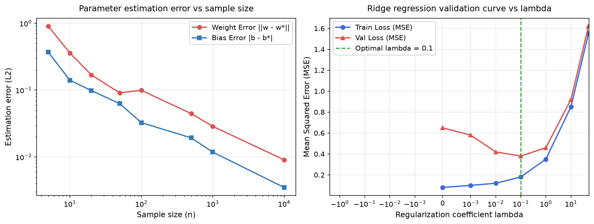

# 3.7. Weight Decay: Suy giảm Trọng số và Kỹ thuật Điều chuẩn trong Học sâu

Nguồn tham khảo: [3.7.6. Exercises: Dive into Deep Learning 1.0.3](https://d2l.ai/chapter_linear-regression/weight-decay.html#exercises).

---

### Bài 1: Effect of the regularization strength

**Đề bài:** Khảo sát ảnh hưởng của hệ số điều chuẩn $\lambda > 0$ đối với sai số huấn luyện và sai số kiểm định trong bài toán hồi quy Ridge. Phân tích hình thái đường cong chữ U (U-shaped validation curve).

**Phân tích toán học:**

Hàm mục tiêu hồi quy tuyến tính có điều chuẩn $L_2$ (Weight Decay / Ridge Regression):

$$\mathcal{L}_{\text{reg}}(\mathbf{w}) = \frac{1}{2n} \|\mathbf{X}\mathbf{w} - \mathbf{y}\|_2^2 + \frac{\lambda}{2} \|\mathbf{w}\|_2^2$$

Nghiệm giải tích bình phương tối thiểu:

$$\hat{\mathbf{w}}_\lambda = (\mathbf{X}^\top \mathbf{X} + n \lambda \mathbf{I})^{-1} \mathbf{X}^\top \mathbf{y}$$

1. **Động học của $\lambda$:**
   - Khi $\lambda \to 0$: Mô hình suy biến về hồi quy OLS không điều chuẩn. Trọng số tự do khớp với nhiễu của tập huấn luyện, dẫn đến sai số huấn luyện $\mathcal{R}_{\text{train}}$ nhỏ nhất nhưng sai số kiểm định $\mathcal{R}_{\text{val}}$ có thể rất lớn do phương sai cao (hiện tượng quá khớp - Overfitting).
   - Khi $\lambda \to \infty$: Nghiệm bị co cứng hoàn toàn về gốc tọa độ $\hat{\mathbf{w}}_\lambda \to \mathbf{0}$. Cả sai số huấn luyện và sai số kiểm định đều bùng nổ do độ chệch lớn (hiện tượng dưới khớp - Underfitting).
   - Với $\lambda$ tối ưu ở vùng trung gian, sự cân bằng giữa độ chệch và phương sai (Bias-Variance Tradeoff) giúp sai số kiểm định $\mathcal{R}_{\text{val}}$ đạt giá trị cực tiểu toàn cục, tạo thành hình thái đường cong chữ U đặc trưng.

**Kết quả thực nghiệm mô phỏng:**
Hình vẽ dưới đây thể hiện sự biến thiên của MSE huấn luyện và MSE kiểm định khi quét $\lambda$ qua thang đo log từ $10^{-5}$ đến $10^2$ (đồ thị bên phải).

---

### Bài 2: Selecting λ with validation

**Đề bài:** Phân tích phương pháp lựa chọn siêu tham số $\lambda$ tối ưu bằng tập kiểm định validation và những rủi ro thống kê liên quan.

**Phân tích và Lời giải:**

Quy trình chuẩn hóa bao gồm việc thiết lập lưới giá trị hình học (geometric grid) $\lambda \in \{10^{-4}, 10^{-3}, \dots, 10^2\}$ và chọn giá trị $\lambda^*$ tối thiểu hóa hàm mất mát trên tập kiểm định độc lập:

$$\lambda^* = \arg\min_{\lambda} \mathcal{L}_{\text{val}}(\hat{\mathbf{w}}_\lambda)$$

- **Tính tương đối của nghiệm tối ưu:** Giá trị $\lambda^*$ thu được chỉ là giá trị tối ưu cục bộ trên lưới tìm kiếm hữu hạn đối với một phân vùng dữ liệu cụ thể.
- **Rủi ro rò rỉ thông tin kiểm định (Overfitting the Validation Set):** Nếu việc dò quét $\lambda$ và các siêu tham số khác được lặp lại quá nhiều lần trên cùng một tập validation cố định, mô hình sẽ vô tình khai thác các đặc tính ngẫu nhiên của tập validation đó. Để đảm bảo tính khách quan khoa học, bắt buộc phải bảo lưu một tập kiểm thử độc lập thứ ba (Test Set) chỉ được đánh giá duy nhất một lần sau khi toàn bộ siêu tham số đã được chốt.

---

### Bài 3: L1 regularization update

**Đề bài:** Thiết lập phương trình cập nhật gradient descent cho mô hình hồi quy có điều chuẩn $L_1$ (Lasso Regularization). So sánh cơ chế tạo tính thưa (sparsity) của $L_1$ với cơ chế co trọng số trơn của $L_2$.

**Phân tích và Lời giải:**

Hàm mục tiêu điều chuẩn $L_1$:

$$\mathcal{J}(\mathbf{w}) = \mathcal{L}(\mathbf{w}) + \lambda \|\mathbf{w}\|_1 = \mathcal{L}(\mathbf{w}) + \lambda \sum_{j=1}^d |w_j|$$

Do hàm trị tuyệt đối không khả vi tại $w_j = 0$, ta sử dụng toán tử dưới gradient (subgradient):

$$\partial |w_j| = \begin{cases} 
\{1\} & \text{khi } w_j > 0 \\ 
[-1, 1] & \text{khi } w_j = 0 \\ 
\{-1\} & \text{khi } w_j < 0 
\end{cases} = \operatorname{sign}(w_j)$$

Quy tắc cập nhật tham số SGD theo từng thành phần:

$$w_j^{(t+1)} = w_j^{(t)} - \eta \frac{\partial \mathcal{L}}{\partial w_j} - \eta \lambda \operatorname{sign}\left(w_j^{(t)}\right)$$

- **So sánh $L_1$ và $L_2$:**
  - Trong điều chuẩn $L_2$ (Weight Decay), số hạng phạt tỷ lệ thuận với độ lớn trọng số ($-\eta \lambda w_j$), làm tốc độ co giảm dần khi trọng số tiến gần 0 (trọng số tiệm cận 0 nhưng hiếm khi bằng chính xác 0).
  - Trong điều chuẩn $L_1$, lực kéo điều chuẩn là một hằng số cố định $-\eta \lambda \operatorname{sign}(w_j)$ không phụ thuộc độ lớn trọng số. Lực kéo liên tục này triệt tiêu các trọng số nhỏ về chính xác bằng 0, tạo ra các vector trọng số thưa (sparse weights) có tác dụng như một cơ chế lựa chọn đặc trưng tự động (feature selection).

---

### Bài 4: Frobenius norm as a trace

**Đề bài:** Biểu diễn bình phương chuẩn Frobenius của ma trận trọng số $\mathbf{W} \in \mathbb{R}^{m \times n}$ thông qua toán tử vết ma trận (Trace).

**Chứng minh:**

Chuẩn Frobenius của ma trận $\mathbf{W}$ được định nghĩa là căn bậc hai của tổng bình phương tất cả các phần tử:

$$\|\mathbf{W}\|_F = \sqrt{\sum_{i=1}^m \sum_{j=1}^n W_{i, j}^2}$$

Xét ma trận tích $\mathbf{W}^\top \mathbf{W} \in \mathbb{R}^{n \times n}$. Phần tử trên đường chéo chính thứ $j$ là:

$$[\mathbf{W}^\top \mathbf{W}]_{j, j} = \sum_{i=1}^m [\mathbf{W}^\top]_{j, i} [\mathbf{W}]_{i, j} = \sum_{i=1}^m W_{i, j}^2$$

Lấy vết (tổng các phần tử trên đường chéo chính) của $\mathbf{W}^\top \mathbf{W}$:

$$\operatorname{tr}(\mathbf{W}^\top \mathbf{W}) = \sum_{j=1}^n [\mathbf{W}^\top \mathbf{W}]_{j, j} = \sum_{j=1}^n \sum_{i=1}^m W_{i, j}^2 = \|\mathbf{W}\|_F^2$$

Do tính chất hoán vị vòng quanh của vết ma trận ($\operatorname{tr}(\mathbf{A}\mathbf{B}) = \operatorname{tr}(\mathbf{B}\mathbf{A})$), ta cũng có:

$$\|\mathbf{W}\|_F^2 = \operatorname{tr}(\mathbf{W}^\top \mathbf{W}) = \operatorname{tr}(\mathbf{W} \mathbf{W}^\top)$$

---

### Bài 5: Other ways to reduce overfitting

**Đề bài:** Tổng hợp các phương pháp điều chuẩn và kỹ thuật kiểm soát hiện tượng quá khớp (Overfitting) trong các kiến trúc học sâu hiện đại.

**Hệ thống các phương pháp Điều chuẩn:**

1. **Tăng cường dữ liệu (Data Augmentation):** Mở rộng không gian mẫu bằng các phép biến đổi bảo toàn ngữ nghĩa (xoay ảnh, cắt xén, Mixup, CutMix).
2. **Dừng sớm (Early Stopping):** Giám sát sai số kiểm định và dừng huấn luyện tại thời điểm khoảng cách tổng quát hóa bắt đầu phân kỳ.
3. **Kỹ thuật ngắt kết nối ngẫu nhiên (Dropout):** Ngắt ngẫu nhiên các nơ-ron với xác suất $p$ trong pha forward để ngăn chặn sự đồng thích ứng phức tạp (co-adaptation).
4. **Chuẩn hóa tầng (Batch / Layer / Group Normalization):** Làm mượt cảnh quan mất mát (loss landscape) và ổn định phân phối kích hoạt ẩn.
5. **Làm mịn nhãn (Label Smoothing):** Ngăn chặn mô hình đưa ra các dự đoán quá tự tin (overconfident logits).
6. **Phương pháp kết hợp mô hình (Ensemble Methods):** Kết hợp dự đoán của nhiều mô hình độc lập (Bagging, Snapshot Ensembles) để triệt tiêu phương sai sai số.

---

### Bài 6: Bayesian interpretation of regularization

**Đề bài:** Thiết lập mối liên hệ giải tích giữa ước lượng Hậu nghiệm Cực đại (Maximum A Posteriori - MAP) trong Thống kê Bayes với các số hạng điều chuẩn $L_2$ và $L_1$.

**Chứng minh:**

Theo định lý Bayes, phân phối xác suất hậu nghiệm của vector trọng số $\mathbf{w}$ khi đã quan sát dữ liệu $\mathcal{D} = \{(\mathbf{x}_i, y_i)\}_{i=1}^n$:

$$p(\mathbf{w} \mid \mathcal{D}) = \frac{p(\mathcal{D} \mid \mathbf{w}) p(\mathbf{w})}{p(\mathcal{D})} \propto p(\mathcal{D} \mid \mathbf{w}) p(\mathbf{w})$$

Ước lượng MAP tìm giá trị $\mathbf{w}$ cực đại hóa xác suất hậu nghiệm:

$$\hat{\mathbf{w}}_{\text{MAP}} = \arg\max_{\mathbf{w}} \left[ \ln p(\mathcal{D} \mid \mathbf{w}) + \ln p(\mathbf{w}) \right] = \arg\min_{\mathbf{w}} \left[ -\ln p(\mathcal{D} \mid \mathbf{w}) - \ln p(\mathbf{w}) \right]$$

Trong đó:
- $-\ln p(\mathcal{D} \mid \mathbf{w})$ tương ứng với hàm mất mát chuẩn $\mathcal{L}(\mathbf{w})$.
- $-\ln p(\mathbf{w})$ đóng vai trò chính xác là **số hạng điều chuẩn (regularization penalty)** $\mathcal{R}(\mathbf{w})$.

1. **Phân phối tiên nghiệm Gauss $\implies$ Điều chuẩn $L_2$ (Weight Decay):**
   Giả định phân phối tiên nghiệm là phân phối chuẩn đẳng hướng: $\mathbf{w} \sim \mathcal{N}(\mathbf{0}, \sigma_w^2 \mathbf{I})$.
   $$p(\mathbf{w}) = \left(\frac{1}{2\pi\sigma_w^2}\right)^{d/2} \exp\left(-\frac{\|\mathbf{w}\|_2^2}{2\sigma_w^2}\right) \implies -\ln p(\mathbf{w}) = \frac{1}{2\sigma_w^2} \|\mathbf{w}\|_2^2 + \text{const}$$
   Đồng nhất hệ số với hồi quy Ridge cho ta $\lambda = \frac{\sigma^2}{\sigma_w^2}$ (tỷ lệ giữa phương sai nhiễu quan sát và phương sai tiên nghiệm của trọng số).
2. **Phân phối tiên nghiệm Laplace $\implies$ Điều chuẩn $L_1$ (Lasso):**
   Giả định $\mathbf{w} \sim \text{Laplace}(\mathbf{0}, b \mathbf{I})$ với $p(\mathbf{w}) = \prod_{j=1}^d \frac{1}{2b}\exp\left(-\frac{|w_j|}{b}\right)$.
   $$-\ln p(\mathbf{w}) = \frac{1}{b} \sum_{j=1}^d |w_j| + \text{const} = \frac{1}{b} \|\mathbf{w}\|_1 + \text{const}$$
   Tương ứng chính xác với số hạng phạt $L_1$ trong hồi quy Lasso.
