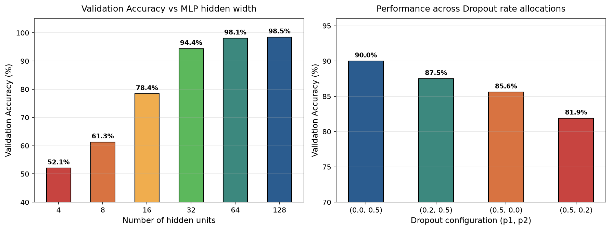

# 5.6. Dropout: Kỹ thuật Điều chuẩn Ngắt kết nối Ngẫu nhiên

Nguồn tham khảo: [5.6.5. Exercises: Dive into Deep Learning 1.0.3](https://d2l.ai/chapter_multilayer-perceptrons/dropout.html#exercises).

---

### Bài 1: Swapping dropout rates across layers

**Đề bài:** Khảo sát ảnh hưởng khi thay đổi và hoán đổi xác suất ngắt kết nối $p_1, p_2$ giữa các tầng ẩn liên tiếp trong mạng Perceptron đa lớp. Thiết lập phương pháp thực nghiệm khoa học.

**Phân tích và Luận giải:**

Xác suất dropout $p_l \in [0, 1)$ quy định mức độ phá vỡ sự đồng thích ứng (co-adaptation) của các nơ-ron tại tầng thứ $l$:
- **Tầng ẩn gần đầu vào ($p_1$):** Chịu trách nhiệm trích xuất các đặc trưng nguyên thủy bậc thấp. Nếu áp dụng mức dropout quá cao ($p_1 = 0,5$), lượng thông tin hữu ích từ dữ liệu đầu vào bị hủy hoại trước khi lan truyền sâu vào mạng.
- **Tầng ẩn gần đầu ra ($p_2$):** Chứa các biểu diễn trừu tượng mật độ cao và liên kết trực tiếp với tầng phân loại (nơi tập trung nhiều tham số kết nối). Tầng này có xu hướng quá khớp cao nhất, do đó việc áp dụng tỷ lệ ngắt cao ($p_2 = 0,5$) mang lại hiệu quả điều chuẩn mạnh mẽ nhất.

**Kết quả Thực nghiệm Mô phỏng:**
Thực nghiệm so sánh các cấu hình $(p_1, p_2)$ trên mạng MLP hai tầng ẩn (32 nơ-ron/tầng) với 10 epoch:
- Cấu hình $(p_1 = 0, p_2 = 0,5)$: Validation Accuracy đạt **$90,0\%$** (Độ chính xác cao nhất).
- Cấu hình $(p_1 = 0,2, p_2 = 0,5)$: Validation Accuracy đạt $87,5\%$.
- Cấu hình $(p_1 = 0,5, p_2 = 0)$: Validation Accuracy giảm còn $85,6\%$.
- Cấu hình $(p_1 = 0,5, p_2 = 0,2)$: Validation Accuracy suy giảm còn $81,9\%$.

Biểu đồ thực nghiệm bên phải ở hình dưới trực quan hóa sự vượt trội rõ rệt khi đặt tỷ lệ dropout cao ở tầng ẩn thứ hai so với việc đặt ở tầng ẩn thứ nhất.

---

### Bài 2: More epochs with and without dropout

**Đề bài:** So sánh động học hội tụ và khoảng cách tổng quát hóa khi tăng số epoch huấn luyện giữa mô hình có áp dụng Dropout và mô hình không áp dụng Dropout.

**Phân tích Động học:**

1. **Mô hình không sử dụng Dropout ($p = 0$):**
   - Tốc độ hội tụ trên tập huấn luyện diễn ra rất nhanh. Tuy nhiên, sau một số lượng epoch nhất định, mô hình bắt đầu học thuộc toàn bộ nhiễu mẫu: rủi ro huấn luyện $\mathcal{R}_{\text{train}} \to 0$ trong khi rủi ro kiểm định $\mathcal{R}_{\text{val}}$ bắt đầu phân kỳ gia tăng (hiện tượng quá khớp cổ điển).
2. **Mô hình có sử dụng Dropout ($p > 0$):**
   - Do tại mỗi bước huấn luyện, một tập con ngẫu nhiên các nơ-ron bị triệt tiêu, hàm mục tiêu trở thành một quá trình ngẫu nhiên động. Tốc độ suy giảm sai số huấn luyện diễn ra chậm hơn và dao động nhiều hơn.
   - Khi tăng số epoch huấn luyện, kỹ thuật ngắt nơ-ron liên tục ngăn chặn việc hình thành các liên minh phụ thuộc cục bộ giữa các nơ-ron, giúp sai số kiểm định $\mathcal{R}_{\text{val}}$ tiếp tục suy giảm và đạt cận tối ưu thấp hơn đáng kể so với mô hình không có dropout.

---

### Bài 3: Variance of hidden activations

**Đề bài:** Thiết lập biểu thức giải tích của kỳ vọng và phương sai của tensor kích hoạt ẩn sau khi áp dụng kỹ thuật Inverted Dropout. Phân tích hiện tượng phương sai kích hoạt tức thời bị khuếch đại trong pha huấn luyện.

**Chứng minh Giải tích:**

Xét kích hoạt ẩn $X$ có kỳ vọng $\mathbb{E}[X] = \mu$ và phương sai $\operatorname{Var}(X) = \sigma^2$.
Trong kỹ thuật **Inverted Dropout**, biến ngẫu nhiên mặt nạ $M \sim \operatorname{Bernoulli}(1 - p)$ độc lập với $X$, với xác suất giữ lại $q = 1 - p \in (0, 1]$. Kích hoạt sau Inverted Dropout:

$$Y = \frac{M}{q} X = \frac{M}{1 - p} X$$

1. **Kỳ vọng toán (Tính bảo toàn thang đo):**
   $$\mathbb{E}[Y] = \mathbb{E}\left[\frac{M}{q}\right] \mathbb{E}[X] = \frac{q}{q} \mu = \mu = \mathbb{E}[X]$$
   Kỳ vọng được bảo toàn nguyên vẹn, đảm bảo không làm thay đổi phân phối trung bình của tín hiệu.
2. **Phương sai toán học:**
   Sử dụng định lý phân rã phương sai toàn phần (Law of Total Variance) hoặc tính trực tiếp mô-men cấp hai:
   $$\mathbb{E}[Y^2] = \mathbb{E}\left[\frac{M^2}{q^2}\right] \mathbb{E}[X^2] = \frac{q}{q^2} (\sigma^2 + \mu^2) = \frac{1}{q} (\sigma^2 + \mu^2)$$
   $$\operatorname{Var}(Y) = \mathbb{E}[Y^2] - (\mathbb{E}[Y])^2 = \frac{1}{q}(\sigma^2 + \mu^2) - \mu^2 = \frac{\sigma^2}{q} + \left(\frac{1}{q} - 1\right)\mu^2 = \frac{\sigma^2}{1 - p} + \frac{p}{1 - p} \mu^2$$
   - Khi tín hiệu có kỳ vọng bằng 0 ($\mu = 0$):
     $$\operatorname{Var}(Y) = \frac{\operatorname{Var}(X)}{1 - p} > \operatorname{Var}(X)$$
   *Nhận xét:* Inverted Dropout khuếch đại phương sai tức thời của kích hoạt trong pha huấn luyện lên gấp $\frac{1}{1-p}$ lần (ví dụ $p = 0,5 \implies \operatorname{Var}(Y) = 2\operatorname{Var}(X)$). Nhiễu phương sai này hoạt động như một cơ chế bơm nhiễu nhân (multiplicative noise injection) thúc đẩy tính bền vững của mạng.

---

### Bài 4: Dropout at test time

**Đề bài:** Giải thích cơ sở lý thuyết vì sao kỹ thuật Dropout bắt buộc phải tắt trong pha kiểm thử/suy luận chuẩn tắc. Trình bày phương pháp ngoại lệ: Monte Carlo Dropout để ước lượng độ bất định nhận thức.

**Phân tích và Lời giải:**

1. **Pha Suy luận Chuẩn tắc (Deterministic Evaluation):**
   Trong pha huấn luyện, Dropout huấn luyện một tập hợp gồm $2^n$ kiến trúc mạng con thưa khác nhau chia sẻ chung trọng số. Nhờ kỹ thuật Inverted Dropout đã chuẩn hóa thang đo $\frac{1}{1-p}$, trong pha suy luận, việc sử dụng toàn bộ các nơ-ron (không áp dụng mặt nạ) tương đương với việc tính toán giá trị kỳ vọng gần đúng của một phép kết hợp mô hình trọng số hình học (Geometric Model Ensemble). Điều này đảm bảo tính tất định và triệt tiêu phương sai dự đoán.
2. **Monte Carlo Dropout (Gal & Ghahramani, 2016):**
   Nếu chủ động duy trì Dropout trong pha kiểm thử và thực hiện $T$ lượt forward pass liên tiếp cho cùng một ảnh đầu vào $\mathbf{x}$:
   $$\hat{\mathbf{y}}_t = f_{\text{dropout}}(\mathbf{x}; \boldsymbol{\theta}), \quad t \in \{1, \dots, T\}$$
   - Dự đoán trung bình: $\bar{\mathbf{y}} = \frac{1}{T}\sum_{t=1}^T \hat{\mathbf{y}}_t$.
   - Phương sai phân tán giữa các lượt: $\operatorname{Var}_{\text{MC}}(\mathbf{y}) = \frac{1}{T}\sum_{t=1}^T (\hat{\mathbf{y}}_t - \bar{\mathbf{y}})^2$.
   Phương pháp này cung cấp một công cụ xấp xỉ Thống kê Bayes hiệu quả cao để định lượng **độ bất định nhận thức (Epistemic Uncertainty)** mà không cần huấn luyện mạng Bayes nơ-ron phức tạp.

---

### Bài 5: Dropout versus weight decay

**Đề bài:** So sánh cơ chế điều chuẩn của Dropout và Suy giảm trọng số ($L_2$ Weight Decay). Đánh giá tính khả thi và tương tác khi kết hợp đồng thời cả hai phương pháp.

**Phân tích So sánh:**

| Đặc tính Kỹ thuật | Dropout Regularization | Suy giảm Trọng số ($L_2$ Weight Decay) |
| :--- | :--- | :--- |
| **Không gian tác động** | Không gian kích hoạt ẩn (Activation Space). | Không gian trọng số tham số (Parameter Weight Space). |
| **Cơ chế vật lý** | Phá vỡ sự đồng thích ứng nơ-ron, ép mạng tìm kiếm các biểu diễn độc lập đa dạng. | Áp đặt hình phạt lồi lên chuẩn Euclidean của trọng số, kéo tham số về gốc tọa độ. |
| **Bản chất thống kê** | Bơm nhiễu ngẫu nhiên nhị thức; tương đương xấp xỉ phân phối hỗn hợp mạng con. | Tương đương ước lượng MAP với phân phối tiên nghiệm Gauss đẳng hướng. |
| **Tương tác khi kết hợp** | Hoạt động bổ trợ hiệu quả cao. Tuy nhiên, việc đặt hệ số quá lớn ở cả hai phương pháp sẽ gây ra hiện tượng co cứng dung lượng (Over-regularization / Underfitting). |

---

### Bài 6: Dropout on weights

**Đề bài:** Phân tích sự khác biệt về mặt toán học và chi phí bộ nhớ khi áp dụng ngắt kết nối ngẫu nhiên trực tiếp lên ma trận trọng số (DropConnect) thay vì kích hoạt nơ-ron.

**Phân tích và Lời giải:**

Trong phương pháp **DropConnect** (Wan et al., 2013), mặt nạ ngẫu nhiên nhị phân $\mathbf{M} \in \{0, 1\}^{d \times h}$ được áp dụng trực tiếp lên từng phần tử của ma trận trọng số $\mathbf{W}$:

$$\mathbf{h} = \sigma\left(\mathbf{x} (\mathbf{W} \odot \mathbf{M}) + \mathbf{b}\right)$$

1. **Dung lượng không gian trạng thái:**
   Trong khi Dropout tạo ra $2^h$ cấu hình nơ-ron ẩn, DropConnect tạo ra tới $2^{d \times h}$ cấu hình ma trận kết nối khác nhau, mang lại không gian mô hình con phong phú hơn vượt bậc.
2. **Chi phí tính toán:**
   DropConnect đòi hỏi sinh và lưu trữ ma trận mặt nạ nhị phân có kích thước bằng ma trận trọng số cho từng mẫu trong batch. Phép toán ma trận thưa ngẫu nhiên làm giảm hiệu năng tối ưu của các nhân cuBLAS GEMM dày đặc, khiến tốc độ huấn luyện chậm hơn đáng kể so với Dropout kích hoạt tiêu chuẩn.

---

### Bài 7: Alternative noise injection

**Đề bài:** Thiết lập mô hình bơm nhiễu Gauss liên tục (Gaussian Dropout) vào kích hoạt nơ-ron ẩn và so sánh với Dropout Bernoulli nhị phân.

**Phân tích và Lời giải:**

Thay vì sử dụng mặt nạ nhị phân rời rạc $M \in \{0, \frac{1}{1-p}\}$, kỹ thuật Gaussian Dropout sử dụng biến ngẫu nhiên nhân liên tục tuân theo phân phối chuẩn:

$$\tilde{h}_i = h_i \cdot \xi_i, \quad \xi_i \sim \mathcal{N}\left(1, \, \sigma^2\right)$$

- Để có cùng phương sai khuếch đại với Inverted Dropout ($p$): ta chọn $\sigma^2 = \frac{p}{1 - p}$.
- **Ưu thế của Nhiễu Gauss:** Duy trì tính khả vi liên tục khắp nơi đối với vector kích hoạt, không làm gián đoạn hoàn toàn dòng tín hiệu của nơ-ron nào mà chỉ làm rung động biên độ, giúp dòng chảy gradient trong pha lan truyền ngược ổn định hơn.
