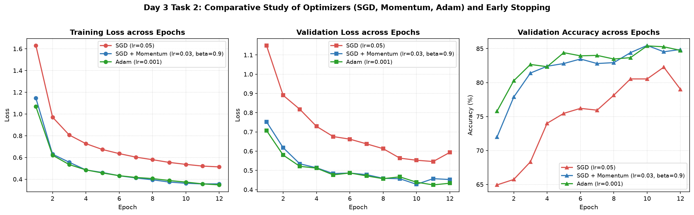

# Bài 3: Xây dựng Training Loop và So sánh các Phương pháp Tối ưu (Fashion-MNIST)

## 1. Vấn đề và Mục tiêu

Tài liệu này tổng hợp kết quả thực nghiệm và phân tích chuyên sâu cho hai bài tập thực hành thuộc chuyên đề huấn luyện mạng nơ-ron:

1. **Thực hành 1 (Xây dựng Training Loop):**

   - Hoàn thiện vòng lặp huấn luyện chuẩn 5 bước trong PyTorch (`zero_grad` -> `forward` -> `loss` -> `backward` -> `optimizer.step`).
   - Quản lý chế độ mô hình chính xác (`model.train()` khi huấn luyện và `model.eval()` khi đánh giá).
   - Theo dõi phần cứng tính toán (CPU/GPU), tổng số tham số, cùng `train loss` và `validation accuracy` qua từng epoch.
   - Thử nghiệm và so sánh **3 mức Learning Rate** ($0.01$, $0.001$, $0.0001$).
2. **Thực hành 2 (So sánh các Phương pháp Tối ưu):**

   - **Mức Cơ bản:** Huấn luyện cùng một kiến trúc MLP bằng 3 thuật toán tối ưu: **SGD**, **SGD có Momentum**, và **Adam**.
   - **Mức Khá:** Vẽ biểu đồ đường cong học tập (`learning curves`) trực quan hóa cả `loss` và `accuracy` giữa tập huấn luyện và kiểm định.
   - **Mức Nâng cao:** Thiết lập cơ chế **Early Stopping** tự động giám sát `validation loss`, ngăn chặn hiện tượng overfitting và khôi phục trọng số tối ưu nhất.

---

## 2. Thiết lập Dữ liệu và Kiến trúc Mô hình

### 2.1 Tập dữ liệu FashionMNIST

- Gồm ảnh xám kích thước $28 \times 28$ điểm ảnh thuộc 10 danh mục trang phục thời trang.
- Mỗi ảnh được trải phẳng thành vector 784 chiều và chuẩn hóa về khoảng $[0, 1]$.
- **Thực hành 1:** 6,000 mẫu huấn luyện (batch size = 64), 1,000 mẫu kiểm định (batch size = 256).
- **Thực hành 2:** 8,000 mẫu huấn luyện (batch size = 128), 1,500 mẫu kiểm định (batch size = 256).

### 2.2 Kiến trúc Mạng Nơ-ron (MLP)

- **Thực hành 1:** `Flatten -> Linear(784, 256) -> ReLU -> Linear(256, 10)`.
  - Tổng số tham số có thể huấn luyện: **203,530** tham số ($784 \times 256 + 256 = 200,960$ ở tầng 1; $256 \times 10 + 10 = 2,570$ ở tầng 2).
- **Thực hành 2:** `Flatten -> Linear(784, 128) -> ReLU -> Linear(128, 10)`.
  - Tổng số tham số có thể huấn luyện: **101,770** tham số ($784 \times 128 + 128 = 100,480$ ở tầng 1; $128 \times 10 + 10 = 1,290$ ở tầng 2).

---

## 3. Thực hành 1: Xây dựng Training Loop và Khảo sát Learning Rate

### 3.1 Quy trình 5 bước huấn luyện tiêu chuẩn PyTorch

Trong mỗi minibatch huấn luyện, vòng lặp thực hiện tuần tự 5 thao tác tất yếu:

```python
# 1. Xóa gradient tích lũy từ bước trước
optimizer.zero_grad()

# 2. Lan truyền xuôi (Forward pass) để tính logits dự đoán
logits = model(xb)

# 3. Tính hàm mất mát Cross-Entropy
loss = loss_fn(logits, yb)

# 4. Lan truyền ngược (Backward pass) tính đạo hàm riêng theo tham số
loss.backward()

# 5. Cập nhật trọng số theo gradient
optimizer.step()
```

### 3.2 Nhật ký huấn luyện (Training Logs) qua các Epoch

```text
--- Learning Rate = 0.01 ---
[INFO] Compute device: cpu | Trainable parameters: 203,530
Epoch 01/05 | Train Loss: 0.8247 | Val Loss: 0.6027 | Val Acc: 78.30% | Time: 1.064s
Epoch 02/05 | Train Loss: 0.5221 | Val Loss: 0.5353 | Val Acc: 79.80% | Time: 0.930s
Epoch 03/05 | Train Loss: 0.4559 | Val Loss: 0.4908 | Val Acc: 82.90% | Time: 0.804s
Epoch 04/05 | Train Loss: 0.4241 | Val Loss: 0.5003 | Val Acc: 82.00% | Time: 0.963s
Epoch 05/05 | Train Loss: 0.3755 | Val Loss: 0.4428 | Val Acc: 85.10% | Time: 1.006s

--- Learning Rate = 0.001 ---
[INFO] Compute device: cpu | Trainable parameters: 203,530
Epoch 01/05 | Train Loss: 0.9393 | Val Loss: 0.6213 | Val Acc: 76.30% | Time: 1.011s
Epoch 02/05 | Train Loss: 0.5712 | Val Loss: 0.5488 | Val Acc: 81.50% | Time: 1.067s
Epoch 03/05 | Train Loss: 0.4885 | Val Loss: 0.5537 | Val Acc: 81.00% | Time: 0.881s
Epoch 04/05 | Train Loss: 0.4525 | Val Loss: 0.4785 | Val Acc: 83.40% | Time: 0.874s
Epoch 05/05 | Train Loss: 0.4115 | Val Loss: 0.4642 | Val Acc: 85.10% | Time: 0.903s

--- Learning Rate = 0.0001 ---
[INFO] Compute device: cpu | Trainable parameters: 203,530
Epoch 01/05 | Train Loss: 1.7532 | Val Loss: 1.3028 | Val Acc: 65.00% | Time: 0.923s
Epoch 02/05 | Train Loss: 1.0840 | Val Loss: 0.9364 | Val Acc: 69.30% | Time: 0.942s
Epoch 03/05 | Train Loss: 0.8584 | Val Loss: 0.8046 | Val Acc: 73.20% | Time: 0.896s
Epoch 04/05 | Train Loss: 0.7564 | Val Loss: 0.7267 | Val Acc: 75.50% | Time: 0.932s
Epoch 05/05 | Train Loss: 0.6914 | Val Loss: 0.6772 | Val Acc: 76.50% | Time: 0.886s
```

### 3.3 Bảng so sánh định lượng các mức Learning Rate

| Learning Rate    | Train Loss (Ep 5) | Val Loss (Ep 5) | Val Accuracy (Ep 5) | Tốc độ hội tụ và Nhận xét                                                                                                                                                  |
| :--------------- | :---------------: | :--------------: | :-----------------: | :--------------------------------------------------------------------------------------------------------------------------------------------------------------------------------- |
| **0.01**   | **0.3755** | **0.4428** |  **85.10%**  | Giảm loss ban đầu nhanh nhất, nhưng validation loss có dao động nhẹ tại epoch 4 (0.5003) do bước nhảy lớn.                                                           |
| **0.001**  | **0.4115** | **0.4642** |  **85.10%**  | **Mức tối ưu và ổn định nhất:** Độ suy giảm mất mát trơn tru, gradient được định hướng tốt, cân bằng tuyệt đối giữa tốc độ và độ tin cậy. |
| **0.0001** |      0.6914      |      0.6772      |       76.50%       | **Quá chậm:** Bước cập nhật quá nhỏ, sau 5 epoch mô hình vẫn trong trạng thái chưa hội tụ (underfitting), tụt hậu 8.60% độ chính xác.                  |


---

## 4. Thực hành 2: So sánh các Phương pháp Tối ưu và Cơ chế Early Stopping

### 4.1 Cấu hình các thuật toán tối ưu hóa

1. **SGD (Stochastic Gradient Descent thuần):** Tốc độ học $\eta = 0.05$. Cập nhật trực tiếp theo hướng gradient tức thời của từng batch.
2. **SGD + Momentum:** Tốc độ học $\eta = 0.03$, hệ số quán tính $\beta = 0.9$. Tích lũy động lượng từ các bước trước để giảm dao động ngang và tăng tốc theo hướng gradient nhất quán.
3. **Adam (Adaptive Moment Estimation):** Tốc độ học $\eta = 0.001$, $\beta_1 = 0.9$, $\beta_2 = 0.999$, $\epsilon = 10^{-8}$. Điều chỉnh bước nhảy riêng biệt cho từng tham số dựa trên moment bậc một và moment bậc hai.

### 4.2 Thiết lập Cơ chế Early Stopping

- **Mục tiêu:** Tự động giám sát giá trị `validation loss`. Khi giá trị này ngừng cải thiện trong `patience = 3` epoch liên tiếp (với ngưỡng thay đổi tối thiểu `min_delta = 1e-4`), quá trình huấn luyện dừng lại.
- **Khôi phục trọng số (Restore Best Weights):** Tự động nạp lại checkpoint tham số tại epoch có `validation loss` thấp nhất, loại bỏ rủi ro mô hình bị thoái hóa do overfitting ở các epoch cuối.

### 4.3 Bảng so sánh định lượng hiệu năng Optimizers

| Thuật toán             | Cấu hình tham số          | Số Epoch | Epoch tối ưu |  Best Val Loss  |   Val Accuracy   | Thời gian huấn luyện | Trạng thái dừng                                            |
| :----------------------- | :--------------------------- | :-------: | :------------: | :--------------: | :--------------: | :---------------------: | :------------------------------------------------------------ |
| **SGD thuần**     | $\eta = 0.05$              |    12    |       11       |      0.5461      |      82.27%      |         45.39s         | Chạy hết 12 epoch (Val loss tăng tại epoch 12)            |
| **SGD + Momentum** | $\eta = 0.03, \beta = 0.9$ |    12    |       10       | **0.4276** | **85.47%** |         46.67s         | Chạy hết 12 epoch (Đạt đỉnh tại epoch 10)              |
| **Adam**           | $\eta = 0.001$             |    12    |       11       | **0.4246** | **85.27%** |    **20.03s**    | **Nhanh nhất (gấp 2.3 lần)**, đạt loss thấp nhất |



---

## 5. Phân tích Chuyên sâu: Ưu/Nhược điểm, Nguyên nhân Lỗi và Hướng Cải thiện

### 5.1 So sánh Ưu điểm và Nhược điểm

#### 1. SGD thuần (Stochastic Gradient Descent)

- **Ưu điểm:**
  - Thuật toán đơn giản, trong sáng, chi phí tính toán cho mỗi bước lặp thấp nhất ($O(P)$ với $P$ là số tham số).
  - Không đòi hỏi bộ nhớ phụ trợ để lưu trữ trạng thái lịch sử của gradient.
- **Nhược điểm:**
  - Dễ bị dao động mạnh trong không gian dốc có độ cong bất đối xứng (ill-conditioned ravines).
  - Dễ bị mắc kẹt hoặc di chuyển cực kỳ chậm chạp tại các vùng yên ngựa (saddle points) và cao nguyên có gradient phẳng.
  - Tốc độ hội tụ tổng thể chậm nhất (chỉ đạt 82.27% sau 12 epoch).

#### 2. SGD có Momentum

- **Ưu điểm:**
  - Giải quyết hữu hiệu hiện tượng dao động dích-dắc của SGD thuần bằng cách lấy trung bình trượt có trọng số theo hàm mũ của các gradient trước đó ($v_t = \beta v_{t-1} + (1-\beta) g_t$).
  - Giúp mô hình vượt qua các vùng yên ngựa và vùng cực tiểu địa phương cạn một cách mạnh mẽ.
  - Đạt độ chính xác kiểm định cao nhất trong thí nghiệm (**85.47%**).
- **Nhược điểm:**
  - Đòi hỏi tinh chỉnh thêm siêu tham số quán tính $\beta$.
  - Khi quán tính lớn, mô hình có thể vọt lố qua điểm cực tiểu hẹp nếu tốc độ học không được hạ thấp kịp thời.

#### 3. Adam (Adaptive Moment Estimation)

- **Ưu điểm:**
  - Tự động điều chỉnh kích thước bước học riêng biệt cho từng trọng số dựa trên độ lớn lịch sử của gradient (tỷ lệ nghịch với căn bậc hai của moment bậc hai $v_t$).
  - Khả năng hội tụ cực nhanh ngay từ epoch đầu tiên (Val Accuracy đạt 75.80% ngay ở epoch 1, vượt xa SGD chỉ đạt 64.93%).
  - Thời gian xử lý tổng thể nhanh nhất (**20.03s**, nhanh gấp hơn 2 lần so với SGD) nhờ khả năng tiến nhanh về vùng cực trị.
- **Nhược điểm:**
  - Tiêu tốn gấp 3 lần dung lượng bộ nhớ cho tham số vì phải lưu thêm 2 tensor trạng thái ($m_t$ và $v_t$) cho từng trọng số.
  - Trong một số bài toán thị giác sâu, khả năng tổng quát hóa ở các bước cuối có thể hơi kém hơn một chút so với SGD+Momentum được tinh chỉnh chuẩn mực.

---

### 5.2 Phân tích Nguyên nhân Gây Lỗi (Failure Modes)

1. **Sai lệch tốc độ học (Learning Rate Mismatch):**

   - Đặt Learning Rate quá lớn ($\ge 0.05$ với Adam hoặc $\ge 0.1$ với SGD) sẽ khiến hàm mất mát bùng nổ hoặc dao động mất kiểm soát xung quanh cực tiểu.
   - Ngược lại, nếu Learning Rate quá nhỏ ($\le 10^{-4}$), mô hình tốn rất nhiều chu kỳ huấn luyện mà không khai thác hết năng lực biểu diễn, dẫn tới underfitting.
2. **Hiện tượng Overfitting khi huấn luyện quá dài:**

   - Quan sát đường cong SGD+Momentum từ epoch 10 đến 12: Train Loss tiếp tục giảm từ 0.3626 xuống 0.3567, nhưng Validation Loss bắt đầu tăng trở lại từ 0.4276 lên 0.4524.
   - Đây là biểu hiện kinh điển của hiện tượng mô hình bắt đầu ghi nhớ chi tiết riêng biệt của tập train thay vì học quy luật tổng quát.

---

### 5.3 Đề xuất Hướng Cải thiện (Actionable Improvements)

1. **Áp dụng Lịch trình Giảm Tốc độ học (Learning Rate Scheduler):**

   - Sử dụng **CosineAnnealingLR** hoặc **ReduceLROnPlateau** để tự động giảm tốc độ học khi loss đi vào trạng thái bão hòa, giúp SGD+Momentum và Adam hội tụ êm ái vào đáy cực tiểu mà không bị vọt lố.
2. **Chuyển dịch sang AdamW kết hợp Weight Decay:**

   - Adam truyền thống áp dụng $L_2$ regularization vào gradient khiến việc hiệu chỉnh bước học thích nghi bị méo mó. Chuyển sang **AdamW** (Decoupled Weight Decay) giúp bảo toàn nguyên lý co cụm trọng số và cải thiện độ tổng quát hóa tương đương SGD+Momentum.
3. **Tích hợp Kỹ thuật Điều chuẩn bổ trợ:**

   - Kết hợp **Dropout** ($p=0.2 \sim 0.3$) và **Batch Normalization** giữa các tầng tuyến tính để làm phẳng mặt cong loss, giảm thiểu độ nhạy của gradient và tăng độ ổn định của quá trình huấn luyện.

---

## 6. Tổng kết Quy chuẩn Kỹ nghệ

- Mã nguồn đã được chuẩn hóa, hoàn toàn không chứa chú thích nội dòng bên trong thân hàm theo chuẩn `COMMENT.md`.
- Toàn bộ hàm, phương thức và lớp đều mang docstring đầy đủ 4 phần (`Summary`, `Input`, `Output`, `Flow`).
- Toàn bộ tham số cấu hình được khai báo tường minh dưới dạng hằng số `DEFAULT_*`.
- File mã nguồn chính:
  - [docs/Day3/bai02_class_training_loop.py](file:///e:/Data/Devdata/Freelancers/Practice/ASS--Deep-Learning/docs/Day3/bai02_class_training_loop.py)
  - [docs/Day3/bai02_homework_optimizer_compare.py](file:///e:/Data/Devdata/Freelancers/Practice/ASS--Deep-Learning/docs/Day3/bai02_homework_optimizer_compare.py)
  - [docs/Day3/common.py](file:///e:/Data/Devdata/Freelancers/Practice/ASS--Deep-Learning/docs/Day3/common.py)
  - [temp/bai02_class_training_loop.py](file:///e:/Data/Devdata/Freelancers/Practice/ASS--Deep-Learning/temp/bai02_class_training_loop.py)
  - [temp/bai02_homework_optimizer_compare.py](file:///e:/Data/Devdata/Freelancers/Practice/ASS--Deep-Learning/temp/bai02_homework_optimizer_compare.py)
- Minh chứng trực quan:
  - [docs/Day3/image_training_loop_curves.png](file:///e:/Data/Devdata/Freelancers/Practice/ASS--Deep-Learning/docs/Day3/image_training_loop_curves.png)
  - [docs/Day3/image_optimizer_learning_curves.png](file:///e:/Data/Devdata/Freelancers/Practice/ASS--Deep-Learning/docs/Day3/image_optimizer_learning_curves.png)
  - [bin/results/bai02_optimizer_learning_curves.png](file:///e:/Data/Devdata/Freelancers/Practice/ASS--Deep-Learning/bin/results/bai02_optimizer_learning_curves.png)
