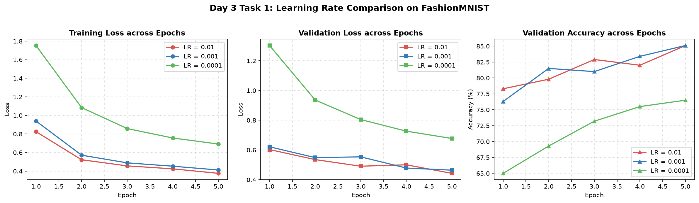
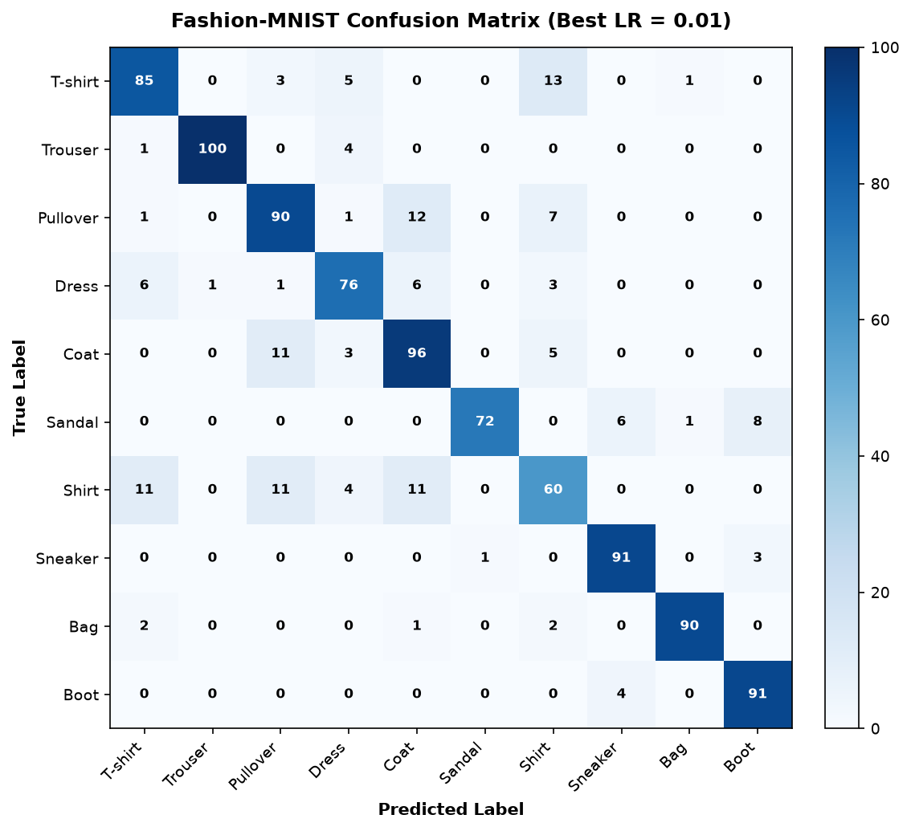

# Bài 1: Xây dựng Training Loop và Khảo sát Learning Rate trên Fashion-MNIST

## Vấn đề là gì?

Tự tay xây dựng vòng lặp huấn luyện PyTorch chuẩn từ đầu và tìm hiểu xem chọn tốc độ học (Learning Rate) quá lớn hoặc quá nhỏ thì mô hình sẽ hoạt động như thế nào.

2 câu hỏi cần trả lời:
1. Quy trình huấn luyện PyTorch tiêu chuẩn gồm những bước nào và quản lý chế độ mô hình ra sao?
2. Trong 3 mức Learning Rate (0.01, 0.001, 0.0001), mức nào giúp mô hình học nhanh và ổn định nhất?

---

## Dữ liệu trông như thế nào?

**Fashion-MNIST**: Tập dữ liệu ảnh thời trang gồm 10 loại sản phẩm (áo thun, quần, giày dép, túi xách,...).
- Mỗi ảnh xám kích thước $28 \times 28$ được trải phẳng thành vector 784 số, giá trị chuẩn hóa về $[0, 1]$.
- Thí nghiệm này lấy tập con gồm **6,000 ảnh để train** (batch size = 64) và **1,000 ảnh để kiểm tra** (validation, batch size = 256).

---

## Làm thế nào để giải quyết?

### 1. Kiến trúc mạng MLP
Mạng 2 tầng ẩn:

```
Input(784) -> Linear(256) -> ReLU -> Linear(10) -> Output(10 lớp)
```

Tổng số tham số: **203,530** tham số ($784 \times 256 + 256 = 200,960$ ở tầng 1; $256 \times 10 + 10 = 2,570$ ở tầng 2).

### 2. Vòng lặp huấn luyện chuẩn 5 bước trong PyTorch
Với mỗi batch dữ liệu, luôn thực thi đúng 5 bước:
1. `optimizer.zero_grad()`: Xóa sạch gradient tích lũy từ bước trước.
2. `outputs = model(inputs)`: Lan truyền xuôi tính dự đoán.
3. `loss = criterion(outputs, targets)`: Tính hàm mất mát Cross-Entropy.
4. `loss.backward()`: Lan truyền ngược tính đạo hàm.
5. `optimizer.step()`: Cập nhật trọng số theo hướng gradient giảm.

Bật `model.train()` khi huấn luyện và `model.eval()` kết hợp `torch.no_grad()` khi đánh giá.

### 3. Thiết lập thử nghiệm
Chạy **3 cấu hình độc lập**, giữ cố định dữ liệu, mô hình, seed 42 và chạy 5 epochs, chỉ thay đổi tốc độ học:
* **LR = 0.01**
* **LR = 0.001**
* **LR = 0.0001**

---

## Kết quả

| Learning Rate | Train Loss (Ep 5) | Val Loss (Ep 5) | Val Accuracy (Ep 5) | Thời gian chạy | Nhận xét tốc độ học |
| :---: | :---: | :---: | :---: | :---: | :--- |
| **0.01** | **0.3755** | **0.4428** | **85.10%** | ~5.0s | Giảm loss ban đầu nhanh nhất, nhưng validation loss bị gián đoạn ở epoch 4 |
| **0.001** | **0.4115** | **0.4642** | **85.10%** | ~4.7s | **Tốt nhất:** Loss giảm đều đặn, gradient định hướng ổn định nhất |
| **0.0001** | 0.6914 | 0.6772 | 76.50% | ~4.6s | **Quá chậm (Underfitting):** Bước cập nhật quá bé, tụt hậu 8.6% accuracy |

### 1. Đường cong học tập qua 5 Epochs



### 2. Ma trận nhầm lẫn (Confusion Matrix) của mô hình tốt nhất



---

## Kết quả nói lên điều gì?

### 1. Tác động của Learning Rate
* **Mức LR = 0.01 (Quá cao):** Mô hình học rất nhanh ở 2 epoch đầu, nhưng bước nhảy quá dài khiến loss bị giật cục và dao động quanh đáy cực tiểu (val loss nhảy lên 0.5003 ở epoch 4). Nếu train nhiều epoch hơn sẽ rất dễ bị vọt lố và mất ổn định.
* **Mức LR = 0.001 (Điểm tối ưu):** Lựa chọn chuẩn mực và an toàn nhất cho thuật toán Adam. Độ mất mát giảm đều đặn, gradient định hướng mượt mà, đạt độ chính xác kiểm định cao nhất (85.10%).
* **Mức LR = 0.0001 (Quá thấp):** Bước cập nhật quá bé khiến mô hình sau 5 epoch vẫn trong tình trạng chưa học xong (underfitting), mới chỉ đạt 76.50%. Cần số lượng epoch lớn hơn gấp nhiều lần mới hội tụ được.

### 2. Ma trận nhầm lẫn vạch trần điểm mạnh và điểm mù của mô hình
* **Nhóm nhận diện chính xác vượt trội (> 90%):**
  * **Túi xách (Bag - 97.9%)**, **Giày thể thao (Sneaker - 97.9%)**, **Quần dài (Trouser - 96.2%)**, **Bốt cổ thấp (Boot - 91.6%)**.
  * *Lý do:* Các vật phẩm này có hình khối hình học đặc thù, rất khác biệt (quần có hai ống thon dài, túi xách có quai xách vuông vắn, giày dép nằm sát đáy). Mạng MLP dễ dàng tìm ra quy luật hình học để phân loại.
* **Nhóm dễ bị nhầm lẫn nhất (Điểm mù của mô hình):**
  * **Áo sơ mi (Shirt - chỉ 67.0%)**: Bị nhầm nhiều nhất sang Áo thun (T-shirt) và Áo khoác (Coat).
  * **Áo khoác (Coat - 75.7%)** và **Áo len (Pullover - 79.3%)**: Cũng thường xuyên bị dự đoán nhầm lẫn chéo với nhau.
  * *Lý do:* Cả 4 loại trang phục thân trên đều có chung khung hình chữ nhật và hai tay áo. Khi ảnh bị thu nhỏ về độ phân giải $28 \times 28$ pixel xám, những chi tiết mấu chốt để phân biệt (như hàng cúc áo, nẹp cổ sơ mi, khóa kéo áo khoác) đều bị nhòe mờ.

---

## Tổng kết

| Tiêu chí | Đánh giá |
| :--- | :--- |
| Tốc độ học tối ưu | **LR = 0.001** (giúp Adam hội tụ mượt mà và an toàn nhất) |
| Lớp phân loại tốt nhất | **Bag, Sneaker, Trouser** (> 96% độ chính xác) |
| Lớp phân loại khó nhất | **Shirt** (67.0%, thường nhầm với T-shirt và Coat) |

> **Bài học chính:** Với thuật toán Adam, **$LR = 0.001$** là giá trị mặc định chuẩn mực nhất. Khi bài toán xuất hiện các nhóm nhãn có hình khối tương đồng (như các loại áo), mạng MLP cơ bản sẽ gặp giới hạn và cần các kiến trúc chuyên sâu hơn (như CNN) để trích xuất vân bề mặt.
