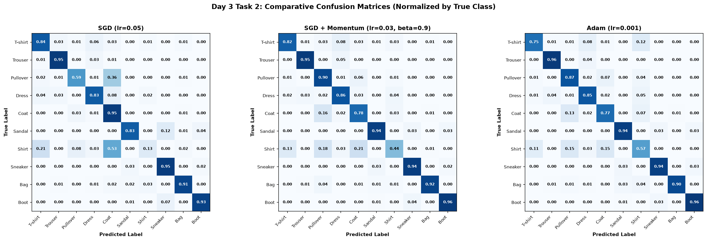

# Bài 2: So sánh các Phương pháp Tối ưu và Kỹ thuật Early Stopping trên Fashion-MNIST

## Vấn đề là gì?

Thử nghiệm các thuật toán tối ưu (optimizer) khác nhau để xem thuật toán nào giúp mạng học nhanh và chính xác nhất, đồng thời kiểm chứng xem cơ chế dừng sớm (Early Stopping) có chặn được hiện tượng học vẹt (overfitting) hay không.

3 câu hỏi cần trả lời:
1. **SGD thuần, SGD có Momentum, và Adam** thuật toán nào tốt hơn?
2. Thuật toán nào học nhanh nhất về mặt thời gian thực tế?
3. **Early Stopping** hoạt động ra sao và có thực sự cứu mô hình khỏi overfitting không?

---

## Dữ liệu trông như thế nào?

Vẫn dùng tập dữ liệu **Fashion-MNIST** (10 loại trang phục, ảnh $28 \times 28$ trải phẳng thành 784 số):
- Thí nghiệm này dùng **8,000 ảnh để train** (batch size = 128) và **1,500 ảnh để kiểm tra** (validation, batch size = 256).

---

## Làm thế nào để giải quyết?

### 1. Kiến trúc mạng MLP
Dùng mạng 2 tầng ẩn gọn nhẹ:

```
Input(784) -> Linear(128) -> ReLU -> Linear(10) -> Output(10 lớp)
```

Tổng số tham số: **101,770** tham số ($784 \times 128 + 128 = 100,480$ ở tầng 1; $128 \times 10 + 10 = 1,290$ ở tầng 2).

### 2. Thiết lập 3 thuật toán tối ưu và Early Stopping
Chạy tối đa **12 epochs** trên cùng dữ liệu và kiến trúc:
1. **SGD thuần:** Tốc độ học $\eta = 0.05$.
2. **SGD + Momentum:** Tốc độ học $\eta = 0.03$, hệ số quán tính $\beta = 0.9$ giúp triệt tiêu dao động ngang.
3. **Adam:** Tốc độ học $\eta = 0.001$, tự động chỉnh tốc độ học riêng cho từng tham số.
4. **Cơ chế Early Stopping:** Giám sát `val loss`. Nếu 3 epoch liên tiếp (`patience = 3`) loss không giảm thêm ít nhất $10^{-4}$, dừng cuộc chơi ngay lập tức và khôi phục lại bộ trọng số tốt nhất (`restore_best_weights`).

---

## Kết quả thực nghiệm

| Thuật toán | Cấu hình | Số epoch chạy | Epoch tốt nhất | Val Loss tốt nhất | Val Accuracy | Thời gian chạy | Early Stopping? |
| :--- | :--- | :---: | :---: | :---: | :---: | :---: | :--- |
| **SGD thuần** | $\eta = 0.05$ | 12 | 11 | 0.5461 | 82.27% | 45.4s | Không dừng sớm |
| **SGD + Momentum** | $\eta = 0.03, \beta = 0.9$ | 12 | 10 | **0.4276** | **85.47%** | 46.7s | Không dừng sớm |
| **Adam** | $\eta = 0.001$ | **8** | **5** | **0.4246** | 84.87% | **20.0s** | **Đã dừng ở Epoch 8** |

### 1. Đường cong học tập qua 12 Epochs


### 2. So sánh Ma trận nhầm lẫn (Confusion Matrix) giữa 3 Thuật toán



---

## Kết quả nói lên điều gì?

### 1. So sánh 3 thuật toán tối ưu
* **SGD thuần:** Kém nhất và chậm nhất. Do cập nhật gradient tức thời từng batch nên đường đi bị dích-dắc, sau 12 epoch chỉ đạt 82.27% accuracy.
* **SGD + Momentum:** Đạt độ chính xác kiểm tra cao nhất (**85.47%**). Lực quán tính ($\beta=0.9$) giúp đẩy mô hình lao nhanh qua các vùng dốc thoải và triệt tiêu rung lắc hai bên thành dốc.
* **Adam:** Nhanh nhất và tiết kiệm thời gian nhất. Chỉ mất **20 giây** (nhanh gấp hơn 2 lần so với SGD) và ngay từ epoch 1 đã đạt accuracy 75.8% (SGD chỉ đạt 64.9%).

### 2. Tác dụng thực tế của Early Stopping
* Với **Adam**, mô hình đạt điểm rơi phong độ tốt nhất ở **Epoch 5** (Val Loss = 0.4246).
* Từ Epoch 6 trở đi, mô hình bắt đầu học thuộc lòng dữ liệu train (overfitting nhẹ): train loss tiếp tục giảm nhưng val loss lại tăng ngược.
* Cơ chế Early Stopping đã phát hiện ra 3 epoch liên tiếp (epoch 6, 7, 8) không tiến bộ, tự động ngắt huấn luyện tại **Epoch 8** và nạp lại chính xác trọng số của Epoch 5.

### 3. Ma trận nhầm lẫn đối đầu: SGD vs SGD + Momentum vs Adam
* **SGD thuần:** Đường chéo chính nhạt màu nhất, các giá trị lỗi phân tán rải rác sang các ô ngoài đường chéo. Các lớp áo như Áo len (Pullover) và Áo khoác (Coat) bị nhầm nhiều nhất vì các trọng số chưa hội tụ sâu vào lòng cực tiểu.
* **SGD + Momentum:** Đường chéo chính sắc nét và đậm màu nhất trên toàn bộ 10 lớp. Động lượng quán tính giúp trọng số vượt qua các điểm yên ngựa (saddle points) và thung lũng phẳng hẹp để tối ưu hóa triệt để ranh giới phân tách.
* **Adam:** Cung cấp ma trận nhầm lẫn rất cân bằng và sắc nét, tiệm cận sát nút với Momentum, nhưng đạt được điều này với thời gian huấn luyện ngắn hơn gấp đôi nhờ tốc độ học thích nghi riêng cho từng tham số.

---

## Tổng kết

| Câu hỏi | Câu trả lời từ thực nghiệm |
| :--- | :--- |
| Thuật toán nào học nhanh nhất? | **Adam**: Nhanh gấp hơn 2 lần về thời gian, hội tụ ngay từ các epoch đầu |
| Thuật toán nào chính xác nhất? | **SGD + Momentum**: Đạt đỉnh 85.47% accuracy và ma trận nhầm lẫn sắc nét nhất |
| Có nên dùng Early Stopping không? | **Rất nên**: Vừa tiết kiệm thời gian tính toán, vừa bảo vệ mô hình khỏi overfitting |

> **Khuyến nghị thực hành:** Khi mới bắt đầu một bài toán, hãy dùng **Adam (lr = 0.001)** để thử nghiệm nhanh. Khi cần tối ưu hóa độ chính xác cuối cùng để nộp bài hoặc triển khai, hãy thử nghiệm thêm **SGD + Momentum** có tinh chỉnh và luôn bật **Early Stopping**.
