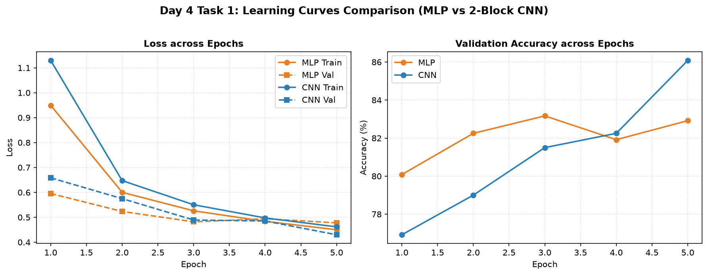
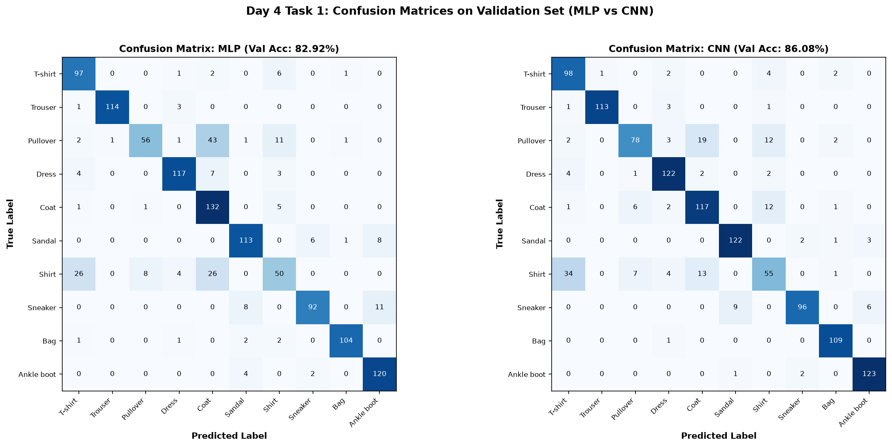

# Bài 1: So sánh MLP và CNN hai block trên Fashion-MNIST

## Vấn đề là gì?

So sánh trực tiếp giữa mạng truyền thống Perceptron đa tầng (MLP) và mạng nơ-ron tích chập (CNN) khi có cùng số lượng tham số (~204 nghìn tham số) để kiểm chứng xem cấu trúc tích chập (CNN) có thực sự vượt trội hơn trên dữ liệu ảnh hay không.

3 câu hỏi cần trả lời:
1. Kích thước tensor thay đổi như thế nào khi đi qua từng tầng tích chập và pooling trong CNN?
2. Khi giữ nguyên điều kiện (cùng dữ liệu, seed 42, optimizer Adam, lr = 0.001, 5 epochs), CNN có đạt độ chính xác cao hơn MLP không?
3. Mô hình nhận diện tốt những loại trang phục nào và hay nhầm lẫn ở đâu?

---

## Dữ liệu trông như thế nào?

**Fashion-MNIST**: Tập dữ liệu ảnh xám $28 \times 28$ gồm 10 loại sản phẩm thời trang.
* **Tập train**: 6,000 ảnh lấy ngẫu nhiên từ tập train chính thức (seed = 42, batch size = 64).
* **Tập validation**: 1,200 ảnh (batch size = 256).
* **Không sử dụng tập test** trong bài tập này để giữ đúng nguyên tắc kiểm định độc lập.

---

## Làm thế nào để giải quyết?

### 1. Kiến trúc hai mô hình thử nghiệm
* **MLP**: Trải phẳng ảnh thành 784 điểm, đi qua 1 tầng ẩn 256 neurons:
  ```text
  Input(1, 28, 28) -> Flatten(784) -> Linear(784, 256) -> ReLU -> Linear(256, 10)
  ```
  Tổng tham số: **203,530**.

* **CNN (2 blocks)**: Sử dụng 2 khối Conv + ReLU + MaxPool:
  ```text
  Block 1: Conv2d(1, 16, k=3, p=1) -> ReLU -> MaxPool2d(2)
  Block 2: Conv2d(16, 32, k=3, p=1) -> ReLU -> MaxPool2d(2)
  Classifier: Flatten(1568) -> Linear(1568, 128) -> ReLU -> Linear(128, 10)
  ```
  Tổng tham số: **206,922**.

Hai mô hình có số lượng tham số gần như tương đương (~204 nghìn so với ~207 nghìn), bảo đảm sự so sánh công bằng.

### 2. Sự thay đổi kích thước Tensor qua từng tầng của CNN
Nhờ `padding=1`, phép tích chập $3 \times 3$ giữ nguyên kích thước không gian. Chỉ có các tầng MaxPool2d(2) làm giảm một nửa chiều rộng và chiều cao:
* **Input ban đầu**: $(1, 1, 28, 28)$
* **Sau Conv1**: $(1, 16, 28, 28)$ (tăng số kênh từ 1 lên 16)
* **Sau Pool1**: $(1, 16, 14, 14)$ (giảm kích thước $28 \rightarrow 14$)
* **Sau Conv2**: $(1, 32, 14, 14)$ (tăng số kênh từ 16 lên 32)
* **Sau Pool2**: $(1, 32, 7, 7)$ (giảm kích thước $14 \rightarrow 7$)
* **Sau Flatten**: $(1, 1568)$ ($32 \times 7 \times 7 = 1,568$ giá trị đầu vào cho Linear)
* **Đầu ra logits**: $(1, 10)$ (10 lớp thời trang)

---

## Kết quả thực nghiệm

| Mô hình | Số tham số | Train Loss (Ep 5) | Val Loss (Ep 5) | Val Accuracy (Ep 5) | Thời gian/Epoch |
| :--- | :---: | :---: | :---: | :---: | :---: |
| **MLP** | 203,530 | 0.4500 | 0.4777 | 82.92% | **1.02s** |
| **CNN** | 206,922 | 0.4616 | **0.4298** | **86.08%** | 1.93s |

### 1. Đường cong học tập qua 5 Epochs



### 2. Ma trận nhầm lẫn (Confusion Matrix) trên tập Validation



---

## Kết quả nói lên điều gì?

### 1. Sức mạnh từ cấu trúc tích chập (Convolutional Inductive Bias)
* Với cùng dung lượng tham số (~204k), **CNN vượt trội hơn MLP tới 3.16 điểm %** (86.08% so với 82.92%).
* Sự vượt trội này hoàn toàn không đến từ việc thêm tham số, mà nhờ CNN bảo toàn cấu trúc không gian 2D của ảnh, sử dụng các bộ lọc cục bộ (local receptive fields) và chia sẻ trọng số (weight sharing), giúp phát hiện các đặc trưng đường nét, góc cạnh bất kể vị trí của chúng trên ảnh.

### 2. Phân tích Ma trận nhầm lẫn
* **Nhóm phân loại tốt nhất (> 90%)**: Cả hai mô hình đều nhận diện rất xuất sắc các lớp có hình khối đặc thù như **Quần dài (Trouser)**, **Túi xách (Bag)**, **Giày thể thao (Sneaker)**, **Bốt (Ankle boot)**.
* **Cải thiện rõ nét của CNN**: Ở lớp **Áo len (Pullover)**, CNN bớt nhầm lẫn sang Áo khoác (Coat) hơn hẳn so với MLP, thể hiện khả năng nắm bắt hoa văn và chất liệu tốt hơn.
* **Điểm mù chung**: Cả hai mô hình đều gặp khó khăn lớn nhất ở lớp **Áo sơ mi (Shirt)** (dưới 60% độ chính xác), thường xuyên bị đoán nhầm thành Áo thun (T-shirt) hoặc Áo khoác (Coat) do ảnh $28 \times 28$ không đủ chi tiết để phân biệt hàng cúc áo và cổ áo.

### 3. Đánh đổi giữa Độ chính xác và Tốc độ tính toán
* MLP học rất nhanh ở 2 epoch đầu tiên và thời gian chạy chỉ mất khoảng 1.02 giây/epoch trên CPU.
* CNN tốn thời gian tính toán gấp gần 2 lần (1.93s/epoch) do các phép tính tích chập trượt trên không gian 2D, nhưng bù lại đường validation loss tiếp tục giảm đều đặn và cho độ chính xác cao hơn rõ rệt.

---

## Tổng kết

| Tiêu chí | Đánh giá |
| :--- | :--- |
| Độ chính xác kiểm định | **CNN dẫn trước 3.16%** (86.08% so với 82.92%) |
| Tốc độ tính toán | **MLP nhanh hơn gần 2 lần** (1.02s so với 1.93s mỗi epoch trên CPU) |
| Lớp phân loại khó nhất | **Shirt** (hay nhầm với T-shirt và Coat ở cả hai mô hình) |

> **Bài học chính:** Đối với dữ liệu thị giác dạng ảnh, kiến trúc tích chập (CNN) luôn là sự lựa chọn vượt trội hơn so với mạng MLP thuần túy. Cấu trúc chia sẻ trọng số và nắm bắt quan hệ lân cận không gian giúp CNN khái quát hóa tốt hơn rất nhiều dù số lượng tham số không hề tăng lên.

