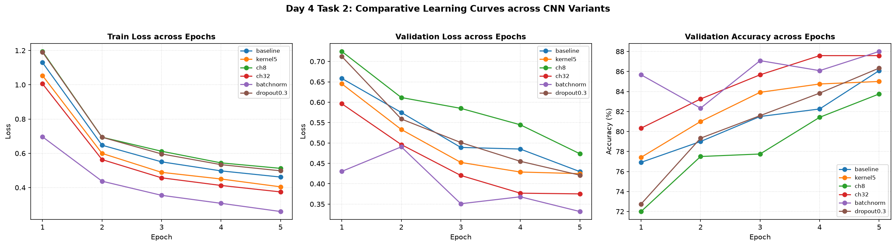
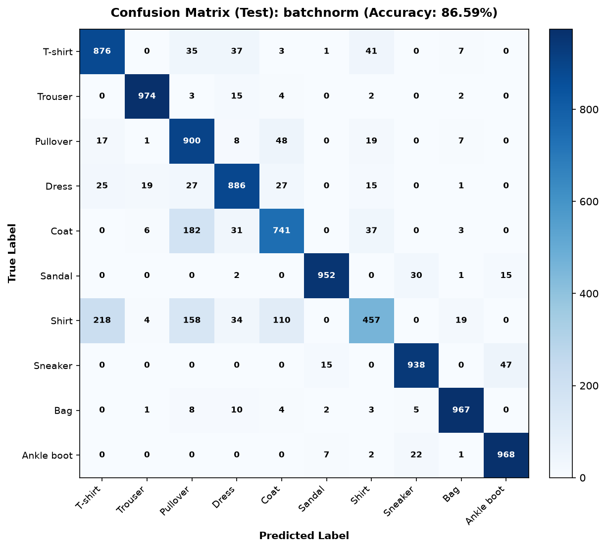
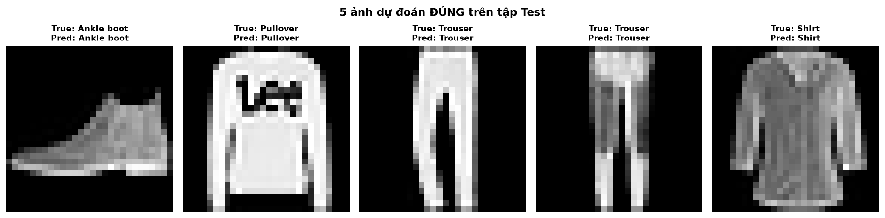
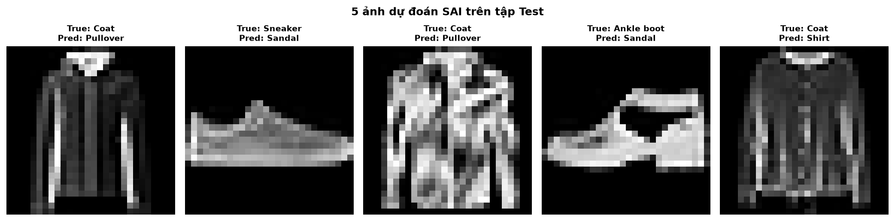

# Bài 2: Khảo sát các Biến thể Kiến trúc CNN trên Fashion-MNIST

## Vấn đề là gì?

Thực hiện phương pháp nghiên cứu loại trừ (Ablation Study) bằng cách mỗi lần chỉ thay đổi đúng một thành phần kiến trúc so với mô hình cơ sở (Baseline) để tìm ra yếu tố nào giúp mạng CNN học nhanh hơn, chính xác hơn và tổng quát hóa tốt nhất.

Các câu hỏi cần trả lời:

1. Đổi kích thước kernel từ $3 \times 3$ sang $5 \times 5$ có giúp tăng độ chính xác không?
2. Giảm số kênh (8) hoặc tăng số kênh (32) ảnh hưởng thế nào đến dung lượng mô hình và thời gian chạy?
3. Chuẩn hóa theo batch (Batch Normalization) hay ngắt kết nối ngẫu nhiên (Dropout) mang lại lợi ích thực sự?
4. Mô hình tốt nhất trên tập kiểm định (Validation) đạt độ chính xác bao nhiêu trên tập kiểm thử chính thức (Official Test Set)?

---

## Dữ liệu trông như thế nào?

Vẫn sử dụng tập dữ liệu **Fashion-MNIST** (10 phân lớp sản phẩm thời trang, ảnh xám $28 \times 28$):

* **Tập train**: 6,000 ảnh từ tập train gốc (seed = 42, batch size = 64).
* **Tập validation**: 1,200 ảnh từ tập train gốc (batch size = 256).
* **Tập test chính thức**: 10,000 ảnh chưa từng thấy trong quá trình huấn luyện và chọn mô hình.

> **Nguyên tắc vàng:** Toàn bộ quá trình so sánh và lựa chọn mô hình chỉ được phép dựa trên tập Validation. Tập Test chính thức chỉ được đem ra đánh giá đúng một lần duy nhất cho mô hình chiến thắng.

---

## Làm thế nào để giải quyết?

### 1. Kiến trúc cơ sở (Baseline)

Mạng CNN 2 blocks:

```text
Block 1: Conv2d(1, 16, k=3, p=1) -> ReLU -> MaxPool2d(2)
Block 2: Conv2d(16, 32, k=3, p=1) -> ReLU -> MaxPool2d(2)
Classifier: Flatten -> Linear(1568, 128) -> ReLU -> Linear(128, 10)
```

### 2. Thiết lập 6 cấu hình thí nghiệm (Ablation Study)

Giữ cố định toàn bộ điều kiện: seed 42, optimizer Adam, lr = 0.001, 5 epochs, chỉ đổi duy nhất 1 thuộc tính:

1. `baseline`: channels = 16, kernel_size = 3, batchnorm = False, dropout = 0.0
2. `kernel5`: tăng kích thước kernel lên **$5 \times 5$** (padding = 2)
3. `ch8`: thu nhỏ số kênh xuống còn **8 kênh** (Block 1: 8, Block 2: 16)
4. `ch32`: mở rộng gấp đôi số kênh lên **32 kênh** (Block 1: 32, Block 2: 64)
5. `batchnorm`: bổ sung **BatchNorm2d** sau mỗi tầng Conv
6. `dropout0.3`: bổ sung **Dropout(0.3)** trước tầng Linear phân loại cuối cùng

---

## Kết quả thực nghiệm

| Cấu hình              |   Số tham số   | Train Loss (Ep 5) | Val Loss (Ep 5) | Val Accuracy (Ep 5) | Thời gian/Epoch | Đánh giá tổng quan                                                      |
| :---------------------- | :---------------: | :---------------: | :--------------: | :-----------------: | :--------------: | :-------------------------------------------------------------------------- |
| `baseline`            |      206,922      |      0.4616      |      0.4298      |       86.08%       |      1.69s      | Chuẩn mực đối chứng                                                    |
| `kernel5`             |      215,370      |      0.4044      |      0.4248      |       85.00%       |      1.90s      | Thêm ~8.4k tham số, accuracy không đổi rõ rệt                        |
| `ch8`                 |      103,018      |      0.5122      |      0.4737      |       83.75%       | **1.58s** | Nhỏ gọn nhất nhưng giảm 2.33% accuracy                                 |
| `ch32`                |      421,642      |      0.3748      |      0.3751      |       87.58%       |      3.45s      | Tham số gấp đôi, chạy chậm gấp đôi                                 |
| **`batchnorm`** | **207,018** | **0.2603** | **0.3319** |  **88.00%**  |      2.25s      | **Tốt nhất toàn diện:** Hội tụ cực nhanh và chính xác nhất |
| `dropout0.3`          |      206,922      |      0.4979      |      0.4211      |       86.33%       |      1.85s      | Tương đương baseline, chưa phát huy tác dụng ở 5 epoch            |

### 1. Đường cong học tập qua 5 Epochs giữa 6 cấu hình



### 2. Đánh giá Mô hình tốt nhất (`batchnorm`) trên Tập Test chính thức

Mô hình `batchnorm` được chọn đại diện để đánh giá trên 10,000 ảnh tập Test:

* **Test Loss**: 0.3797
* **Test Accuracy**: **86.59%** (chênh lệch ~1.4% so với tập validation, phản ánh độ tin cậy thực tế rất cao).



### 3. Minh chứng thực tế: 5 ảnh đoán đúng và 5 ảnh đoán sai

* **5 ảnh dự đoán đúng điển hình**:
  
* **5 ảnh dự đoán sai điển hình**:
  

---

## Kết quả nói lên điều gì?

### 1. BatchNorm là kỹ thuật mang lại tỉ suất hiệu quả cao nhất

* Chỉ thêm đúng **96 tham số** điều chỉnh scale/shift ($\gamma, \beta$), nhưng `batchnorm` giúp val accuracy nhảy vọt từ 86.08% lên **88.00%** và giảm val loss sâu nhất (0.3319).
* Ngay từ epoch 1, `batchnorm` đã đạt accuracy 85.67% (vượt xa baseline chỉ đạt 76.92%). Chuẩn hóa phân phối đầu vào của mỗi tầng giúp triệt tiêu hiện tượng trôi dạt nội bộ (Internal Covariate Shift), cho phép gradient chảy mượt mà.

### 2. Số lượng kênh: Điểm cân bằng nằm ở đâu?

* Giảm xuống 8 kênh (`ch8`): Mô hình bị thiếu dung lượng biểu diễn (Underfitting), train loss và val loss đều cao nhất.
* Tăng lên 32 kênh (`ch32`): Số lượng tham số tăng vọt lên 421,642 (gấp hơn 2 lần) và thời gian train tăng gấp đôi (3.45s/epoch), nhưng độ chính xác (87.58%) vẫn xếp sau `batchnorm`. Điều này chứng minh rằng việc thiết kế luồng xử lý thông minh (Normalization) hiệu quả hơn rất nhiều so với việc chỉ đơn thuần tăng kích thước mô hình.

### 3. Dropout và Kernel size

* **Kernel 5x5 (`kernel5`)**: Mở rộng trường tiếp nhận (receptive field) từ 3x3 lên 5x5 không tạo ra sự khác biệt lớn trên ảnh $28 \times 28$ vì các chi tiết trong Fashion-MNIST khá nhỏ gọn, kích thước 3x3 đã là kích thước tối ưu.
* **Dropout 0.3 (`dropout0.3`)**: Ở 5 epoch đầu tiên trên tập dữ liệu 6,000 ảnh, mô hình chưa hề có dấu hiệu học thuộc vẹt (Overfitting), vì vậy Dropout vô tình làm chậm tốc độ hội tụ của mạng. Dropout sẽ hữu ích hơn khi tăng số lượng epoch lên cao (ví dụ 20 - 50 epochs).

### 4. Giải mã các trường hợp dự đoán sai

Quan sát 5 ảnh bị đoán sai trên tập Test:

* Hầu hết các lỗi tập trung vào việc nhầm lẫn giữa **Áo khoác (Coat)** với **Áo sơ mi (Shirt)**, **Áo thun (T-shirt)** với **Áo sơ mi (Shirt)**, hoặc nhầm lẫn giữa **Giày thể thao (Sneaker)** và **Sandal**.
* Do kích thước ảnh nhỏ ($28 \times 28$), các chi tiết tinh xảo như khuy cúc áo, nẹp cổ sơ mi hay dây quai giày bị tiêu biến thành các khối điểm ảnh tương đồng, dẫn đến việc mô hình dự đoán nhầm các lớp có cùng phom dáng tổng thể.

---

## Tổng kết

| Tiêu chí                                 | Cấu hình xuất sắc nhất     | Lý do                                                                                                        |
| :----------------------------------------- | :------------------------------ | :------------------------------------------------------------------------------------------------------------ |
| **Hiệu năng & Tốc độ hội tụ** | **`batchnorm`**         | Đạt **88.00% val acc**, tăng tốc hội tụ ngay từ epoch 1 với chi phí tham số không đáng kể |
| **Tiết kiệm tài nguyên nhất**   | **`ch8`**               | Chỉ 103k tham số, nhanh nhất nhưng phải đánh đổi 2.3% độ chính xác                               |
| **Kết quả kiểm thử thực tế**   | **86.59% trên Test Set** | Khẳng định tính tổng quát hóa ổn định, không bị học vẹt                                         |

> **Khuyến nghị thực hành:** Trong các bài toán thị giác máy tính với CNN, luôn ưu tiên tích hợp **Batch Normalization** ngay sau các tầng tích chập. Kỹ thuật này giúp ổn định gradient, tăng tốc độ hội tụ và cải thiện độ chính xác mà hầu như không làm tăng tải tính toán.
