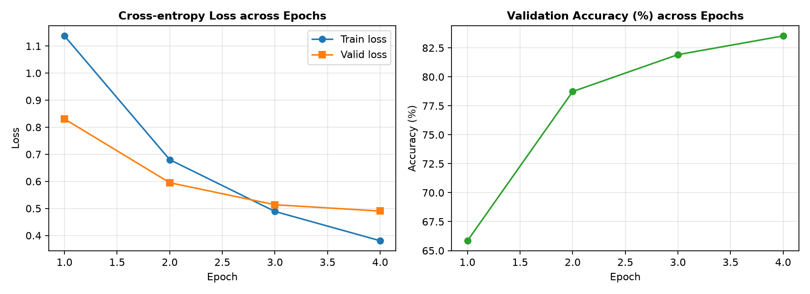
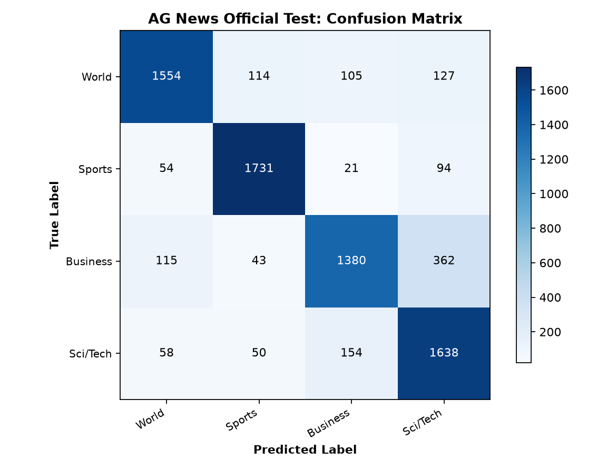

# Bài 1: Phân loại văn bản tin tức AG News bằng mô hình LSTM

## Vấn đề là gì?

Phân loại các bản tin tiếng Anh vào 4 danh mục chủ đề chính: **World** (Thế giới), **Sports** (Thể thao), **Business** (Kinh doanh) và **Sci/Tech** (Khoa học / Công nghệ).

Bài toán này đặt ra 4 câu hỏi kỹ thuật cốt lõi cần giải quyết:
1. Tại sao tập Test phải được cô lập hoàn toàn ngay từ bước xây dựng từ vựng (vocabulary) và chọn mô hình?
2. Cơ chế xử lý chuỗi độ dài biến thiên bằng Dynamic Padding và `pack_padded_sequence` trong PyTorch hoạt động ra sao để tiết kiệm bộ nhớ và tránh tính toán lãng phí trên token `<pad>`?
3. Kiến trúc LSTM một chiều, một tầng có đủ khả năng nắm bắt ngữ cảnh tuần tự của các bản tin để đạt độ chính xác cao hay không?
4. Những bản tin nào bị mô hình đoán sai và nguyên nhân ngữ nghĩa đằng sau sự nhầm lẫn đó là gì?

---

## Dữ liệu trông như thế nào?

**AG News**: Tập dữ liệu chuẩn gồm 120,000 bản tin huấn luyện chính thức và 7,600 bản tin kiểm định độc lập (Test).
* **Quy tắc phân chia dữ liệu**: Toàn bộ tập Test (7,600 mẫu) được khóa kín, không tham gia vào quá trình xây dựng từ vựng hay lựa chọn epoch tốt nhất.
* **Tập Train và Validation**: Phân tách phân tầng (stratified split) từ 120,000 mẫu train chính thức, bảo đảm tỷ lệ đồng đều giữa 4 lớp. Trong thực nghiệm này, tập train sử dụng 15,000 mẫu đại diện và tập validation sử dụng 6,000 mẫu đầy đủ.
* **Đặc tính văn bản**: Độ dài trung bình khoảng 30 đến 45 từ, được cắt ngưỡng tối đa ở `max_len = 80` tokens.
* **4 nhóm nhãn mục tiêu**:
  0. `World` (Chính trị, quan hệ quốc tế, xung đột, địa chính trị)
  1. `Sports` (Giải đấu, cầu thủ, trận đấu, tỷ số thể thao)
  2. `Business` (Doanh nghiệp, thị trường chứng khoán, doanh thu, thương vụ)
  3. `Sci/Tech` (Công nghệ thông tin, phần cứng, Internet, nghiên cứu khoa học)

---

## Làm thế nào để giải quyết?

### 1. Tiền xử lý văn bản và Xây dựng Từ vựng (Vocabulary)
* **Tokenization**: Tách từ bằng biểu thức chính quy `[a-z0-9]+(?:'[a-z]+)?` kết hợp chuyển chữ thường (lowercasing).
* **Xây dựng từ vựng**: Chỉ thống kê tần suất từ trên tập huấn luyện (Train), loại bỏ các từ xuất hiện dưới 2 lần (`min_freq = 2`) và giới hạn kích thước từ điển ở `max_vocab = 12,000`.
* **Ký hiệu đặc biệt**:
  * `<pad>` (ID = 0): Dùng để đệm các câu ngắn trong batch về cùng độ dài.
  * `<unk>` (ID = 1): Dùng để đại diện cho tất cả các từ hiếm hoặc từ mới ngoài từ điển.

### 2. Xử lý độ dài linh hoạt với Dynamic Padding và `pack_padded_sequence`
Thay vì pad cứng toàn bộ tập dữ liệu về một độ dài cố định, quy trình sử dụng bộ gom nhóm động (`collate_batch`):
* Trong mỗi mini-batch, các mẫu chỉ được pad đến độ dài của chuỗi dài nhất trong chính batch đó.
* Lưu giữ mảng `lengths` chứa số token thực tế trước khi pad.
* Trước khi đưa qua LSTM, tensor nhúng được đóng gói bằng `pack_padded_sequence(embedded, lengths.cpu(), batch_first=True, enforce_sorted=False)`. Kỹ thuật này giúp LSTM bỏ qua hoàn toàn các bước tính toán trên token `<pad>`, vừa tăng tốc độ xử lý vừa tránh làm sai lệch trạng thái ẩn cuối cùng (`hidden state`).

### 3. Kiến trúc mô hình LSTM thuần túy
Mô hình tuân thủ thiết kế một chiều, một tầng với luồng xử lý thẳng:
```text
Token IDs [B, T] -> Embedding(12000, 64) -> PackedSequence -> LSTM(64, 96) -> Hidden[-1] [B, 96] -> Linear(96, 4) -> Logits [B, 4]
```
* **Tổng số tham số có thể huấn luyện**: **830,596** tham số.
  * Tầng Embedding: $12,000 \times 64 = 768,000$ tham số.
  * Tầng LSTM: $4 \times (64 \times 96 + 96 \times 96 + 96) = 62,208$ tham số.
  * Tầng phân loại Linear: $96 \times 4 + 4 = 388$ tham số.

### 4. Huấn luyện với Kẹp Gradient (Gradient Clipping)
Sử dụng hàm mất mát `CrossEntropyLoss` kết hợp thuật toán tối ưu `Adam` ($lr = 0.001$). Trong mỗi bước lan truyền ngược, độ chuẩn vector gradient được giới hạn bởi `clip_grad_norm_(model.parameters(), max_norm=1.0)` để ngăn chặn triệt để hiện tượng bùng nổ đạo hàm (exploding gradients) thường gặp ở các mạng hồi quy RNN/LSTM.

---

## Kết quả thực nghiệm

### 1. Tiến trình học tập qua các Epochs

| Epoch | Train Loss | Validation Loss | Validation Accuracy | Validation Macro-F1 | Thời gian/Epoch |
| :---: | :---: | :---: | :---: | :---: | :---: |
| 1 | 1.1593 | 0.8188 | 68.32% | 0.6812 | 31.63s |
| 2 | 0.6739 | 0.6280 | 77.35% | 0.7748 | 29.56s |
| 3 | 0.4743 | 0.5438 | 81.27% | 0.8122 | 41.66s |
| **4** | **0.3650** | **0.4746** | **83.73%** | **0.8376** | **39.62s** |

Checkpoint tại **Epoch 4** được lựa chọn vì đạt giá trị Validation Loss thấp nhất (0.4746) và Validation Accuracy cao nhất (83.73%).

### 2. Đánh giá cuối cùng trên tập Test chính thức (7,600 mẫu)

| Chỉ số đánh giá | Giá trị thực nghiệm |
| :--- | :---: |
| **Test Loss** | **0.4883** |
| **Test Accuracy** | **83.05%** (6,312 / 7,600 câu đúng) |
| **Test Macro-F1** | **0.8308** |
| **Số lượng dự đoán sai** | 1,288 / 7,600 câu (16.95%) |

### 3. Biểu đồ đường cong học tập



### 4. Ma trận nhầm lẫn (Confusion Matrix) trên tập Test



Chi tiết phân bố các lớp trên tập Test (mỗi lớp có đúng 1,900 mẫu):
* **Sports**: Dự đoán chính xác cao nhất với **1,688 / 1,900 mẫu đúng (88.84%)**. Lớp này có từ vựng chuyên ngành thể thao rất đặc thù và ít bị nhầm lẫn.
* **World**: Đạt **1,603 / 1,900 mẫu đúng (84.37%)**.
* **Business**: Đạt **1,519 / 1,900 mẫu đúng (79.95%)**, có 233 mẫu bị nhầm sang Sci/Tech.
* **Sci/Tech**: Đạt **1,502 / 1,900 mẫu đúng (79.05%)**, có 257 mẫu bị nhầm sang Business.

---

## Phân tích các trường hợp dự đoán sai trên tập Test (YC5)

Dưới đây là 3 bản tin thực tế từ tập Test mà mô hình dự đoán sai, kèm theo phân tích nguyên nhân ngữ nghĩa cụ thể:

### Ví dụ 1: Nhầm lẫn giữa Khoa học và Thể thao
* **Văn bản bản tin**:
  > *"Prediction Unit Helps Forecast Wildfires (AP) AP - It's barely dawn when Mike Fitzpatrick starts his shift with a blur of colorful maps, figures and endless charts, but already he knows what the day will bring. Lightning will strike in places he expects. Winds will pick up, moist places will dry and flames will roar."*
* **Nhãn thực tế**: `Sci/Tech` | **Mô hình dự đoán**: `Sports`
* **Nguyên nhân ngữ nghĩa**:
  * Bản tin đưa tin về đơn vị khoa học khí tượng sử dụng mô hình dự báo cháy rừng do sét đánh.
  * Tuy nhiên, các từ khóa trong câu như *"Prediction Unit"*, *"Forecast"*, *"starts his shift"*, *"lightning will strike"* thường xuất hiện dày đặc trong các bản tin thể thao dự đoán kết quả trận đấu, lịch thi đấu và phong độ cầu thủ (ví dụ tiền đạo "strike").
  * Do thiếu các từ khóa kỹ thuật chuyên sâu về máy tính hay công nghệ cao, LSTM bị thu hút bởi các tín hiệu ngữ cảnh mang sắc thái phán đoán thi đấu.

### Ví dụ 2: Nhầm lẫn giữa Công nghệ và Tin thế giới
* **Văn bản bản tin**:
  > *"E-mail scam targets police chief Wiltshire Police warns about 'phishing' after its fraud squad chief was targeted."*
* **Nhãn thực tế**: `Sci/Tech` | **Mô hình dự đoán**: `World`
* **Nguyên nhân ngữ nghĩa**:
  * Bản tin nói về hình thức tấn công lừa đảo qua mạng (phishing email), thuộc chủ đề an ninh mạng / công nghệ.
  * Tuy nhiên, phần lớn độ dài câu lại bị chi phối bởi các thực thể hành pháp: *"police chief"*, *"Wiltshire Police"*, *"warns"*, *"fraud squad chief"*.
  * Trong tập huấn luyện, cụm từ liên quan đến cảnh sát và tội phạm hình sự phân bố áp đảo ở chủ đề World (Tin tức xã hội / Pháp luật quốc tế). Trọng số ẩn của LSTM do đó nghiêng mạnh về lớp World thay vì tập trung vào từ đơn lẻ *"phishing"*.

### Ví dụ 3: Nhầm lẫn giữa Nghiên cứu Khoa học và Kinh doanh
* **Văn bản bản tin**:
  > *"Teenage T. rex's monster growth Tyrannosaurus rex achieved its massive size due to an enormous growth spurt during its adolescent years."*
* **Nhãn thực tế**: `Sci/Tech` | **Mô hình dự đoán**: `Business`
* **Nguyên nhân ngữ nghĩa**:
  * Đây là phát hiện cổ sinh vật học về quá trình phát triển kích thước của khủng long bạo chúa T. rex.
  * Dù vậy, bản tin chứa liên tiếp các từ ngữ: *"growth"*, *"massive size"*, *"enormous growth spurt"*.
  * Trong dữ liệu báo chí tiếng Anh của AG News, từ *"growth"* xuất hiện phần lớn trong các báo cáo tài chính doanh nghiệp (tăng trưởng doanh thu, tăng trưởng thị phần, bùng nổ lợi nhuận). Khi từ chuyên ngành cổ sinh vật học *"Tyrannosaurus rex"* là từ hiếm hoặc bị gán xác suất thấp, mạng tự động liên kết đặc trưng tăng trưởng với danh mục Business.

---

## Kết quả nói lên điều gì?

1. **Hiệu quả của việc đóng gói chuỗi (`pack_padded_sequence`)**:
   * Việc loại bỏ token padding khỏi phép tính ẩn của LSTM giúp mô hình chỉ lấy vector ngữ cảnh tại đúng từ cuối cùng của bản tin, phản ánh trọn vẹn nội dung mà không bị pha loãng bởi các số 0 của padding.
2. **Điểm giao thoa giữa Business và Sci/Tech**:
   * Ma trận nhầm lẫn cho thấy cặp nhãn Business và Sci/Tech có số lượng câu nhầm lẫn qua lại nhiều nhất (gần 500 câu). Điều này phản ánh thực tế ngôn ngữ báo chí hiện đại: các công ty công nghệ lớn (Google, Apple, Microsoft, IBM) thường xuyên xuất hiện đồng thời trong các bản tin về doanh thu, cổ phiếu lẫn sản phẩm công nghệ mới.
3. **Giới hạn của LSTM một chiều (Unidirectional)**:
   * Do chỉ đọc văn bản theo chiều từ trái qua phải, nếu từ khóa quyết định nằm ở đầu câu nhưng đuôi câu lại chứa các từ ngữ phổ biến của chủ đề khác, vector trạng thái cuối cùng có xu hướng thiên vị cho nửa sau của chuỗi. Đây là động lực tự nhiên để mở rộng sang mạng LSTM hai chiều (Bidirectional LSTM) ở Bài 2.

---

## Tổng kết

| Hạng mục | Thông số |
| :--- | :--- |
| **Mô hình** | Single-layer Unidirectional LSTM (Embedding 64, Hidden 96) |
| **Tổng tham số** | 830,596 tham số |
| **Độ chính xác Test** | **83.05%** |
| **Macro-F1 Test** | **0.8308** |
| **Lớp nhận diện tốt nhất** | **Sports** (88.84% độ chính xác) |
| **Cặp nhãn hay nhầm nhất** | **Business** và **Sci/Tech** (do giao thoa ngữ nghĩa về công ty công nghệ và tài chính) |

> **Bài học chính:** Mô hình LSTM một chiều cơ bản với cơ chế `pack_padded_sequence` và gradient clipping xử lý rất tốt bài toán phân loại chuỗi văn bản biến thiên độ dài. Tuy nhiên, để giải quyết triệt để các trường hợp nhầm lẫn từ khóa giao thoa, cần nghiên cứu các kiến trúc sâu hơn hoặc hai chiều như BiLSTM.

