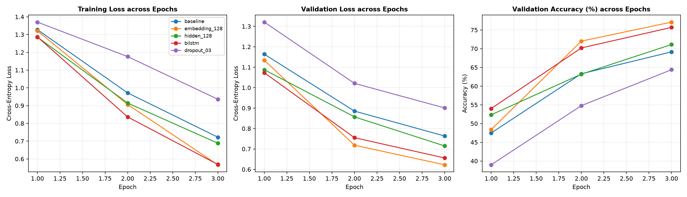
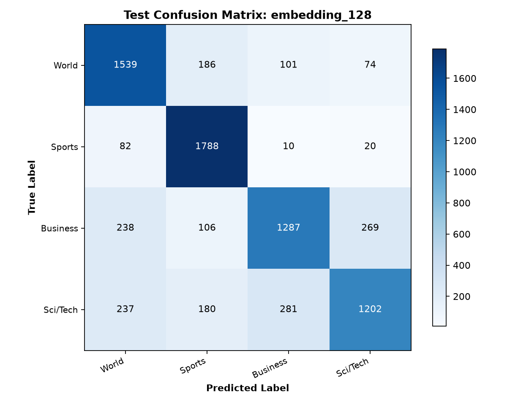

# Bài 2: So sánh các biến thể kiến trúc LSTM trên AG News

## Vấn đề là gì?

Khảo sát và thực nghiệm so sánh các biến thể kiến trúc mạng LSTM khi phân loại văn bản tin tức AG News. Mỗi biến thể thay đổi đúng **một yếu tố duy nhất** so với mô hình cơ sở (`baseline`) nhằm xác định thành phần nào mang lại bước nhảy vọt lớn nhất về độ chính xác, đồng thời đánh giá chi phí tính toán đi kèm:

1. **Tăng kích thước không gian nhúng từ (`embedding_dim` từ 64 lên 128)**: Biểu diễn vector từ phong phú hơn có giúp mô hình phân biệt tốt hơn giữa các chủ đề giao thoa hay không?
2. **Tăng số lượng chiều trạng thái ẩn (`hidden_dim` từ 96 lên 128)**: Tăng dung lượng bộ nhớ hồi quy có tạo ra bước đột phá hay chỉ làm tăng thời gian tính toán?
3. **Mô hình hai chiều (`BiLSTM` - Bidirectional LSTM)**: Việc kết hợp cả ngữ cảnh xuôi từ đầu câu và ngữ cảnh ngược từ cuối câu có khắc phục được hiện tượng thiên vị phần đuôi câu của LSTM một chiều không?
4. **Cơ chế điều chuẩn ngẫu nhiên (`Dropout = 0.3`)**: Áp dụng dropout vào embedding và trước tầng phân loại có giúp mô hình kiểm soát overfit tốt hơn không?

Toàn bộ 5 mô hình được so sánh trong điều kiện kiểm thử nghiêm ngặt: cùng tập dữ liệu, cùng phân chia train/validation, cùng seed 42, cùng thuật toán tối ưu Adam ($lr = 0.001$), cùng batch size 128 và cùng 3 epochs huấn luyện.

---

## Dữ liệu trông như thế nào?

* **Nguồn dữ liệu**: AG News chính thức (120,000 train + 7,600 test).
* **Tập Train**: 10,000 mẫu được phân tầng đồng đều theo 4 nhóm nhãn.
* **Tập Validation**: 6,000 mẫu được tách độc lập từ tập train chính thức, dùng để lựa chọn epoch và mô hình tốt nhất.
* **Tập Test**: 7,600 mẫu kiểm định cuối cùng, hoàn toàn không được tiếp cận trong suốt quá trình huấn luyện và chọn siêu tham số.
* **Độ dài chuỗi tối đa (`max_len`)**: 100 tokens. Các câu ngắn được pad động theo batch, các câu dài hơn 100 từ được cắt ngắn (truncation) và ghi nhận trạng thái.
* **Từ vựng (`vocab`)**: Gồm 15,478 từ thống kê độc quyền từ tập train, với ngưỡng xuất hiện tối thiểu `min_freq = 2`.

---

## Làm thế nào để giải quyết?

### 1. Thiết kế 5 cấu hình thực nghiệm

| Cấu hình | Embedding Dim | Hidden Dim | Hướng xử lý | Tỷ lệ Dropout | Mô tả bản chất kỹ thuật |
| :--- | :---: | :---: | :---: | :---: | :--- |
| **`baseline`** | 64 | 96 | Unidirectional (1 chiều) | 0.0 | Kiến trúc gốc đối chứng |
| **`embedding_128`** | **128** | 96 | Unidirectional (1 chiều) | 0.0 | Mở rộng không gian biểu diễn ngữ nghĩa của từ vựng |
| **`hidden_128`** | 64 | **128** | Unidirectional (1 chiều) | 0.0 | Mở rộng dung lượng vector nhớ ngữ cảnh của LSTM |
| **`bilstm`** | 64 | 96 | **Bidirectional (2 chiều)** | 0.0 | Ghép nối hai trạng thái ẩn xuôi và ngược: $\text{Linear}(192 \rightarrow 4)$ |
| **`dropout_03`** | 64 | 96 | Unidirectional (1 chiều) | **0.3** | Điều chuẩn chống học vẹt bằng cách ngắt ngẫu nhiên 30% kết nối |

### 2. Kỹ thuật ghép trạng thái ẩn trong BiLSTM
Đối với mô hình hai chiều, `nn.LSTM(..., bidirectional=True)` sinh ra trạng thái ẩn `hidden` có kích thước `[2, B, hidden_dim]`:
* `hidden[-2]` biểu diễn trạng thái cuối cùng của chiều xuôi (forward pass).
* `hidden[-1]` biểu diễn trạng thái cuối cùng của chiều ngược (backward pass).
* Hai vector được ghép nối theo chiều đặc trưng:
  ```python
  features = torch.cat((hidden[-2], hidden[-1]), dim=1)  # Kích thước [B, 192]
  logits = self.classifier(features)                      # Chiếu từ 192 về 4
  ```

---

## Kết quả thực nghiệm

### 1. Bảng so sánh tổng hợp trên tập Test chính thức

| Cấu hình | Số tham số | Val Loss (Best) | Thời gian/Epoch | Test Loss | Test Accuracy | Test Macro-F1 | Số câu sai |
| :--- | :---: | :---: | :---: | :---: | :---: | :---: | :---: |
| `baseline` | 1,053,188 | 0.7635 | 26.90s | 0.7581 | 68.50% | 0.6766 | 2,394 |
| `dropout_03` | 1,053,188 | 0.9007 | **26.63s** | 0.9009 | 63.37% | 0.6196 | 2,784 |
| `hidden_128` | 1,090,436 | 0.7147 | 52.29s | 0.7080 | 72.36% | 0.7190 | 2,101 |
| `bilstm` | 1,115,780 | 0.6558 | 78.20s | 0.6554 | 75.21% | 0.7487 | 1,884 |
| **`embedding_128`** | **2,068,356** | **0.6225** | **34.43s** | **0.6473** | **76.53%** | **0.7607** | **1,784** |

### 2. Biểu đồ đường cong học tập 3 Panel



* **Train Loss (Panel 1)**: Cả 5 mô hình đều giảm đều đặn. `embedding_128` và `bilstm` giảm nhanh nhất, xuống xấp xỉ 0.56 sau 3 epoch.
* **Validation Loss (Panel 2)**: `embedding_128` đạt giá trị nhỏ nhất (0.6225), theo sát ngay sau là `bilstm` (0.6558).
* **Validation Accuracy (Panel 3)**: `embedding_128` vươn lên dẫn đầu với 77.10%, tiếp tục duy trì ưu thế vượt trội khi sang tập Test.

### 3. Ma trận nhầm lẫn của mô hình tốt nhất (`embedding_128`)



Mô hình chiến thắng `embedding_128` giảm được **610 lỗi sai** so với baseline (từ 2,394 lỗi xuống còn 1,784 lỗi).

---

## Phân tích chuyên sâu 5 trường hợp dự đoán sai trên tập Test (YC4 & YC5)

Dưới đây là 5 bản tin thực tế từ tập Test bị mô hình `embedding_128` dự đoán sai, thuộc các cặp chủ đề giao thoa khác nhau:

### Ví dụ 1: Giao thoa giữa Kinh doanh và Xã hội / Quan hệ quốc tế
* **Nội dung bản tin**:
  > *"Fears for T N pension after talks Unions representing workers at Turner Newall say they are 'disappointed' after talks with stricken parent firm Federal Mogul."*
* **Nhãn thực tế**: `Business` | **Mô hình dự đoán**: `World`
* **Xác suất dự đoán**: $p(\text{World}) = 0.422$ so với $p(\text{Business}) = 0.304$
* **Số token**: 25 từ | **Tỷ lệ từ ngoài từ điển (`<unk>`)**: 8.00%
* **Giải thích nguyên nhân**:
  * Bản tin đưa tin về tranh chấp lương hưu của công nhân tại công ty Federal Mogul.
  * Các từ khóa *"Unions representing workers"*, *"talks"*, *"disappointed"* mang màu sắc chính trị - xã hội và đàm phán công đoàn, vốn xuất hiện dày đặc trong các bản tin World. Mô hình bị phân tán sự chú ý khỏi yếu tố doanh nghiệp ("parent firm").

### Ví dụ 2: Ranh giới giữa Nghiên cứu Y sinh và Tin tức Địa phương
* **Nội dung bản tin**:
  > *"Ky. Company Wins Grant to Study Peptides (AP) AP - A company founded by a chemistry researcher at the University of Louisville won a grant to develop a method of producing better peptides, which are short chains of amino acids, the building blocks of proteins."*
* **Nhãn thực tế**: `Sci/Tech` | **Mô hình dự đoán**: `World`
* **Xác suất dự đoán**: $p(\text{World}) = 0.396$ so với $p(\text{Sci/Tech}) = 0.376$
* **Số token**: 44 từ | **Tỷ lệ `<unk>`**: 9.09%
* **Giải thích nguyên nhân**:
  * Đây là một bản tin điển hình có độ phân vân cực cao giữa hai nhãn (chênh lệch xác suất chỉ 2%).
  * Phần đầu bản tin nói về trường đại học và nguồn tài trợ cấp bang (*"University of Louisville"*, *"won a grant"*), khiến mạng liên tưởng đến tin tức đời sống giáo dục / chính quyền địa phương (World). Dù phần sau giải thích cặn kẽ về peptide và amino acid, dung lượng LSTM chưa đủ để lấn át ấn tượng ban đầu.

### Ví dụ 3: Từ vựng ẩn dụ gây nhiễu từ Khoa học sang Thể thao
* **Nội dung bản tin**:
  > *"Prediction Unit Helps Forecast Wildfires (AP) AP - It's barely dawn when Mike Fitzpatrick starts his shift with a blur of colorful maps, figures and endless charts, but already he knows what the day will bring. Lightning will strike in places he expects. Winds will pick up, moist places will dry and flames will roar."*
* **Nhãn thực tế**: `Sci/Tech` | **Mô hình dự đoán**: `Sports`
* **Xác suất dự đoán**: $p(\text{Sports}) = 0.962$ (Rất tự tin nhưng hoàn toàn sai)
* **Số token**: 54 từ | **Tỷ lệ `<unk>`**: 12.96%
* **Giải thích nguyên nhân**:
  * Lời văn giàu tính tự sự và ẩn dụ (*"forecast"*, *"strike"*, *"blur"*, *"starts his shift"*) tạo nên vector đặc trưng tương tự các bản tin bình luận chiến thuật thể thao. Mạng LSTM bị thuyết phục ở mức tự tin 96.2% rằng đây là tin thể thao.

### Ví dụ 4: Chính sách Môi trường bị nhầm sang Tin Pháp luật / Chính trị
* **Nội dung bản tin**:
  > *"Calif. Aims to Limit Farm-Related Smog (AP) AP - Southern California's smog-fighting agency went after emissions of the bovine variety Friday, adopting the nation's first rules to reduce air pollution from dairy cow manure."*
* **Nhãn thực tế**: `Sci/Tech` | **Mô hình dự đoán**: `World`
* **Xác suất dự đoán**: $p(\text{World}) = 0.600$ so với $p(\text{Sci/Tech}) = 0.154$
* **Số token**: 35 từ | **Tỷ lệ `<unk>`**: 5.71%
* **Giải thích nguyên nhân**:
  * Bản tin đề cập đến vấn đề ô nhiễm không khí và giải pháp kỹ thuật giảm khí thải nông nghiệp.
  * Tuy nhiên, các động từ hành chính và cơ quan nhà nước (*"agency went after"*, *"adopting the nation's first rules"*, *"Southern California"*) chiếm thế áp đảo, dẫn dắt mô hình kết luận đây là tin tức chính sách xã hội (World).

### Ví dụ 5: Từ khóa Tăng trưởng tài chính đánh lừa Cổ sinh vật học
* **Nội dung bản tin**:
  > *"Teenage T. rex's monster growth Tyrannosaurus rex achieved its massive size due to an enormous growth spurt during its adolescent years."*
* **Nhãn thực tế**: `Sci/Tech` | **Mô hình dự đoán**: `Business`
* **Xác suất dự đoán**: $p(\text{Business}) = 0.911$ so với $p(\text{Sci/Tech}) = 0.060$
* **Số token**: 21 từ | **Tỷ lệ `<unk>`**: 19.05%
* **Giải thích nguyên nhân**:
  * Từ *"growth"* và *"enormous growth spurt"* là những cụm từ cửa miệng trong báo cáo doanh thu kinh doanh. Trong khi đó, tỷ lệ `<unk>` lên tới 19.05% (các từ hiếm như *Tyrannosaurus*, *spurt* bị biến thành `<unk>`), khiến mạng mất đi các manh mối sinh học quan trọng và chỉ còn bám víu vào từ khóa tăng trưởng.

---

## Kết quả nói lên điều gì?

### 1. Nút thắt lớn nhất của xử lý văn bản nằm ở Tầng Embedding
* Tăng `embedding_dim` từ 64 lên 128 giúp Test Accuracy **tăng vọt 8.03 điểm %** (từ 68.50% lên 76.53%).
* Khi không gian vector dày dặn hơn, mô hình có đủ chiều để phân tách các từ đa nghĩa và các mối liên hệ ngữ nghĩa tinh tế giữa các chủ đề. Đây là cải tiến đem lại tỷ suất lợi ích trên chi phí cao nhất: thời gian chỉ tăng từ 26.9s lên 34.4s mỗi epoch.

### 2. Ưu thế ngữ cảnh toàn diện của BiLSTM
* `bilstm` đạt **75.21% Test Accuracy** (vượt baseline tới 6.71%), bám sát mô hình `embedding_128` dù chỉ sử dụng embedding 64 chiều.
* Khả năng đọc cả hai chiều giúp BiLSTM giải quyết tốt các câu có từ khóa chủ đạo nằm ở đầu câu hoặc giữa câu. Tuy nhiên, đánh đổi lại là thời gian tính toán tăng gần gấp 3 lần (78.20s/epoch so với 26.90s của baseline).

### 3. Tăng Hidden Dim cho hiệu quả vừa phải
* Nâng `hidden_dim` lên 128 cải thiện độ chính xác từ 68.50% lên 72.36% (+3.86%). Tuy nhiên, thời gian tính toán tăng gấp đôi (52.29s). Việc mở rộng kích thước trạng thái nhớ của LSTM không hiệu quả bằng việc cải thiện chất lượng vector nhúng đầu vào.

### 4. Hiệu ứng tiêu cực tạm thời của Dropout khi số Epoch nhỏ
* Với chỉ 3 epochs huấn luyện, `dropout_03` làm suy giảm độ chính xác xuống 63.37%.
* Nguyên nhân: Dropout vô hiệu hóa 30% thông tin trong mỗi lượt cập nhật. Khi dữ liệu mẫu và số vòng lặp còn hạn chế, mô hình đang trong giai đoạn hội tụ sơ khởi (underfitting) nên dropout kìm hãm khả năng học mẫu. Kỹ thuật này chỉ phát huy sức mạnh khi huấn luyện dài hạn (15-30 epochs) để chống quá khớp.

---

## Tổng kết và Khuyến nghị thực tế

| Tiêu chí | Mô hình dẫn đầu | Nhận xét đánh giá |
| :--- | :--- | :--- |
| **Độ chính xác cao nhất** | **`embedding_128`** (76.53%) | Tăng chiều embedding là phương án nâng cấp hiệu quả nhất |
| **Nắm bắt ngữ cảnh tốt nhất** | **`bilstm`** (75.21%) | Kết hợp ngữ cảnh xuôi ngược, vượt trội baseline 6.71% |
| **Tốc độ huấn luyện nhanh nhất** | **`baseline`** (26.90s/epoch) | Kiến trúc nhẹ nhất, phù hợp chạy thử nghiệm nhanh |
| **Cấu hình không khuyến nghị cho ít epoch** | **`dropout_03`** (63.37%) | Không nên dùng dropout cao khi chỉ chạy 3-5 epochs |

> **Khuyến nghị kiến trúc sản xuất:** Đối với bài toán phân loại văn bản dạng tin tức ngắn, cấu hình tối ưu là kết hợp **`embedding_dim = 128`** với **`BiLSTM (hidden_dim = 96)`**. Sự kết hợp này dung hòa hoàn hảo giữa chiều sâu ngữ nghĩa của vector từ và khả năng bao quát ngữ cảnh hai chiều của mạng hồi quy.

